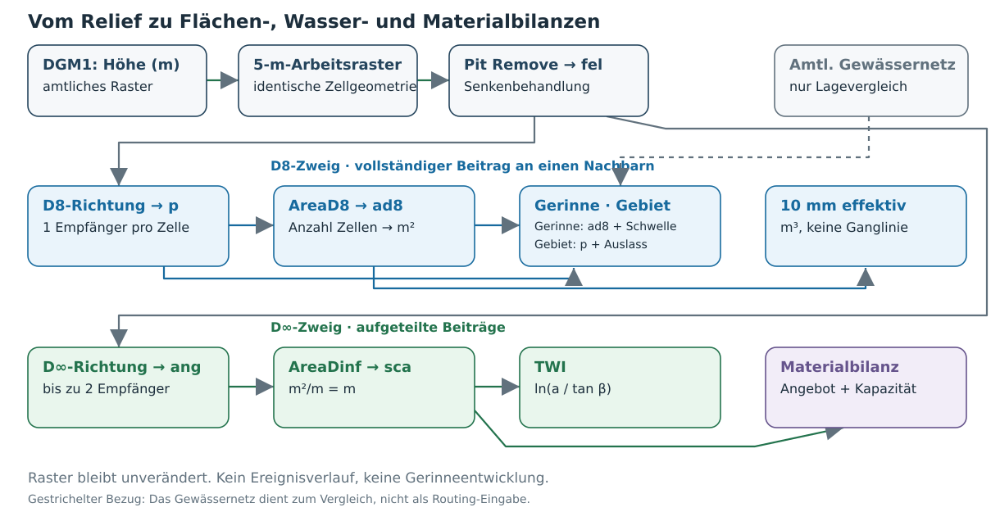
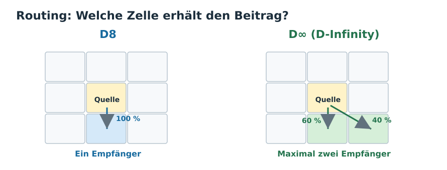
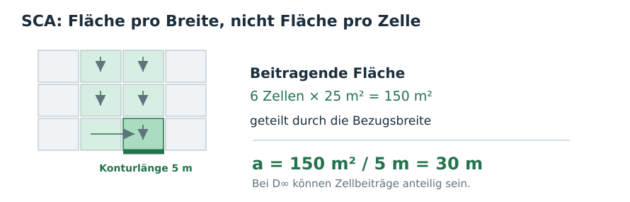
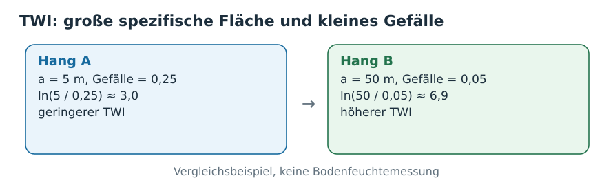
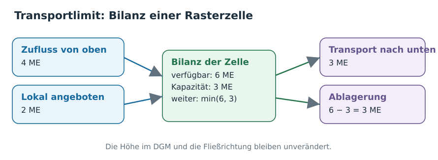

[← Kursübersicht](../index.qmd) · [NetLogo-Vergleich](netlogo_modellvergleich.qmd) · [Modellbildung im GIS](modellbildung_gis_reader.qmd) · [Dokumentation: Daten und Werkzeugfolge](abfluss_algorithmen_quellen.qmd)

## Vom bekannten Beispiel zum eigenen Untersuchungsfall

In NetLogos *Grand Canyon* konnten Tropfen auf einem Relief verfolgt werden: Wo verlaufen ihre Wege, und wo treffen sie zusammen? *Erosion* ergänzte die zeitliche Veränderung des Reliefs, *River Meanders* die Veränderung eines Gerinnes durch Erosions- und Ablagerungsregeln. Jetzt arbeiten wir mit **tatsächlichen Geodaten** – und müssen zunächst selbst ein verwendbares Höhenraster herstellen.

Die Modellkette beantwortet drei verschiedene Fragen: **Wo konzentrieren sich Abflusswege im Gelände? Was folgt, wenn wir zusätzlich eine effektive Abflussmenge annehmen? Was ändert sich durch eine begrenzte Sedimenttransportkapazität?** Das Gelände wird in diesem GIS-Modell **nicht dynamisch verändert**.

Der Arbeitsweg ist in zwei Teile getrennt:

- **Referenzlauf:** Sie führen mit vier bereitgestellten DGM-Kacheln die Datenaufbereitung und eine erste TauDEM-Berechnung aus. Dieser Lauf prüft den *technischen Weg*, ist aber noch keine Untersuchung eines vollständig erfassten Einzugsgebiets.
- **Eigener Fall:** Sie wählen einen Oberlauf, beschaffen dessen DGM-Daten und **übertragen denselben Workflow**. Die anschließenden Modellrechnungen und ihre fachliche Beurteilung beziehen sich auf diesen Fall, nicht auf den Referenzdatensatz.

Ein erfolgreicher Programmlauf ist dabei weder ein Beleg für vollständige Eingangsdaten noch für eine zutreffende Prozessbeschreibung.

## A · Referenzlauf: Vier DGM-Kacheln zu einem Arbeitsraster

### Ausgangsdaten und Datenprüfung

Im Repository liegen unter [`mini-data/`](https://github.com/gisma-courses/geo-mod-2026/tree/main/assets/mini-data/dgm1_32_49.zip) **vier benachbarte DGM1-Kacheln** (je 1 km², zusammen 2 × 2 km). Verwenden Sie diese vier Originaldateien, nicht ein bereits vorbereitetes Gesamt-DGM. Der Beispielordner enthält ausschließlich die für diesen Lauf vorgesehenen GeoTIFF-Kacheln.

Öffnen Sie zunächst eine Kachel in QGIS und lesen Sie unter *Layer-Eigenschaften → Information* Koordinatenreferenzsystem (KBS/CRS), Pixelgröße und Ausdehnung ab. Prüfen Sie anhand der Kachelbezeichnungen und ihrer Ausdehnungen, wie die vier Dateien räumlich aneinanderliegen. Worin liegt der Unterschied zwischen **vier benachbarten Dateien** und **einem einheitlichen Berechnungsraster**?

### Datenaufbereitung als eigener Verarbeitungsschritt

Laden Sie [`scripts/prepare_dgm.py`](../scripts/prepare_dgm.py) über den **QGIS-Processing-Skripteditor** und speichern Sie die Datei dort als Python-Skript. Das Werkzeug erscheint unter **Verarbeitung → Werkzeugkiste → Skripte → Modellieren in der Geographie → DGM vorbereiten: Kacheln mosaikieren und Arbeitsraster erzeugen**.

Starten Sie das Werkzeug mit folgenden Eingaben:

| Parameter | Referenzlauf |
|---|---|
| Ordner mit DGM-Kacheln | `mini-data/` |
| Ergebnisordner | `processing/beispiel/` (getrennt von den Quellkacheln) |
| Zellweite des Arbeitsrasters | **5 m** als Voreinstellung; Wert ist frei wählbar |
| Ziel-KBS | Leer lassen, wenn das Quell-KBS bereits projiziert ist und Meter verwendet; für den Burgwald sonst `EPSG:25832` |

Das Werkzeug prüft zunächst die Georeferenzierung der Kacheln und weist u. a. unterschiedliche Quellgitter und überlappende Kacheln zurück. Dann erzeugt es ein **virtuelles Mosaik** und mit GDAL *Warp/Average* ein gemeinsames GeoTIFF. Bei 5 m entstehen:

| Datei | Aufgabe |
|---|---|
| `processing/beispiel/dgm_mosaik.vrt` | Virtuelles Mosaik; verweist weiterhin auf die ursprünglichen Kacheln |
| `processing/beispiel/dgm5.tif` | Eigenständiges, für TauDEM verwendbares 5-m-Arbeitsraster |
| `processing/beispiel/dgm_pruefung.json` | Verarbeitungsparameter, Kacheleigenschaften, gültige/ungültige Zellen und Prüfsummen |

**Prüfen Sie die Ausgaben**, statt nur eine Erfolgsmeldung zu übernehmen: Sind alle vier Kacheln enthalten? Sind an den Übergängen erkennbare Sprünge oder fehlende Werte vorhanden? Stimmen CRS, Ausdehnung und Pixelgröße? Was wurde bei der Reduktion von DGM1 auf 5 m verändert? Das Prüfprotokoll dokumentiert technische Eigenschaften; es garantiert **nicht**, dass das Gelände fachlich vollständig oder fehlerfrei ist.

Welche GDAL-Werkzeuge das Skript in welcher Reihenfolge mit welchen Parametern aufruft, ist in der [Dokumentation der DGM-Aufbereitung](abfluss_algorithmen_quellen.qmd) aufgeführt.

::: {.callout-note collapse="true"}
## Technisch: Was dieses Werkzeug tut – und was ausdrücklich nicht

`prepare_dgm.py` übernimmt **ausschließlich die Rasteraufbereitung**: Kacheln prüfen, VRT bilden, ein auf ein Zielgitter ausgerichtetes GeoTIFF erzeugen und das Ergebnis dokumentieren. Die originale DGM1-Auflösung bleibt in den Quellkacheln erhalten; das Arbeitsraster entsteht durch Mittelwertbildung (*Average*) bei der Umrechnung. Kleine NoData-Lücken können dabei verdeckt werden. Das ist keine hydrologische Senkenfüllung.

**`Pit Remove`, D8, D∞, Einzugsgebiete und Sedimenttransport gehören zum separaten TauDEM-Skript.** Halten Sie diese Trennung auch bei späteren Änderungen ein.

Die VRT-Datei ist kein eigenständiges Datenarchiv: Verschieben Sie die referenzierten Quellkacheln nicht nachträglich. Das Werkzeug überschreibt bestehende Ausgaben nicht; für eine andere Zellweite oder einen zweiten Lauf einen eigenen Ergebnisordner wählen. Es liest GeoTIFFs unmittelbar aus dem gewählten Ordner, nicht aus Unterordnern.
:::

### Vom Höhenmodell zu berechneten Abflusswegen

Wir haben aus den vier DGM-Kacheln ein zusammenhängendes Höhenraster erzeugt. Es enthält für jede Rasterzelle die Geländehöhe. **Wie lässt sich daraus ableiten, wohin Wasser aufgrund des Geländes fließen würde und wo sich Zuflüsse sammeln?**

Dafür verwenden wir das vorbereitete TauDEM-Werkzeug.

Öffnen Sie `scripts/taudem_burgwald_processing.py` im QGIS-Processing-Skripteditor und speichern Sie es dort. Sie finden das Werkzeug anschließend unter **Verarbeitung → Skripte → Modellieren in der Geographie → TauDEM: Abflusswege, Einzugsgebiet, Wasser, Sediment**.

Wählen Sie:

- **Berechnung:** `1 – Grundlage`
- **DGM:** `processing/beispiel/dgm5.tif`
- **Ergebnisordner:** `results/beispiel/`

Starten Sie die Berechnung. TauDEM und MPI müssen dafür installiert sein. Lassen Sie die voreingestellte Prüfung auf Randeinflüsse aktiviert.

::: {.callout-note collapse="true"}
## Windows: QGIS, TauDEM und MPI installieren

Für die folgenden Berechnungen benötigen Sie **QGIS**, **TauDEM 5.5.0** und **Microsoft MPI**.

1. **QGIS installieren:** Laden Sie die aktuelle Windows-Version von [qgis.org](https://qgis.org/download/) herunter und installieren Sie sie.
2. **TauDEM installieren:** Laden Sie den [offiziellen TauDEM-5.5.0-Komplettinstaller](https://github.com/dtarb/TauDEM/releases/tag/v5.5.0) (`TauDEM550_setup_x64.exe`) herunter und führen Sie ihn aus. Der Komplettinstaller enthält auch Microsoft MPI.
3. **Processing-Skript einbinden:** Öffnen Sie [`taudem_burgwald_processing.py`](../scripts/taudem_burgwald_processing.py) im QGIS-Processing-Skripteditor und speichern Sie es dort.
4. **Installation prüfen:** Öffnen Sie das Werkzeug unter *Verarbeitung → Werkzeugkiste → Skripte → Modellieren in der Geographie*. Wählen Sie **Berechnung 1 – Grundlage**, das vorbereitete DGM und einen leeren Ergebnisordner.
5. **Programmpfade kontrollieren:** Falls TauDEM oder MPI nicht automatisch gefunden werden, geben Sie im Werkzeugdialog das Installationsverzeichnis der TauDEM-Programme und den vollständigen Pfad zu `mpiexec.exe` an.

Ein erfolgreicher Test erzeugt unter anderem `fel.tif`, `p.tif` und `ad8.tif`. Öffnen Sie die Raster in QGIS und prüfen Sie, ob sie gültige Werte enthalten.

**Linux:** Die Installation wird in diesem Kurs nicht unterstützt. Für Linux existiert auf Nachfrage eine separate lokale Lösung.


:::

#### Was hat das Werkzeug berechnet?

Öffnen Sie die folgenden Raster in QGIS und betrachten Sie sie nacheinander:

| Raster | Was zeigt es? |
|---|---|
| `fel.tif` | Das Höhenmodell nach der Behandlung geschlossener Senken. |
| `p.tif` | Für jede Zelle eine kodierte Fließrichtung zu einer ihrer acht Nachbarzellen. |
| `ad8.tif` | Wie viele Rasterzellen über diese Fließverbindungen zu einer bestimmten Zelle beitragen. |
| `src_2ha.tif` | Potenzielle Gerinnelinien ab 2 ha beitragender Fläche. |
| `src_5ha.tif` | Potenzielle Gerinnelinien ab 5 ha beitragender Fläche. |

**Untersuchen Sie zunächst `ad8.tif`.** Die Werte sind auf den Hängen meist klein und werden dort größer, wo viele Fließwege zusammenkommen. Auf diese Weise können sich aus den Geländehöhen verzweigte Abflussnetze ergeben – ohne dass wir zuvor Bäche eingezeichnet haben.

Ein Beispiel: Bei 5 m Rasterweite umfasst jede Zelle 25 m². Steht in `ad8.tif` der Wert 800, tragen nach der D8-Routingregel 800 Zellen zu diesem Punkt bei. Das entspricht einer Fläche von 20.000 m² beziehungsweise 2 ha.

Vergleichen Sie anschließend `src_2ha.tif` und `src_5ha.tif`. Bei der höheren Schwelle erscheinen nur noch diejenigen Abschnitte als Gerinne, an denen mindestens 5 ha beitragen.

**Was verändert sich dadurch – und was nicht?** Werden die Abflussrichtungen neu berechnet oder entscheiden wir lediglich anders, ab welcher beitragenden Fläche wir von einem Gerinne sprechen?

#### Was sagt uns dieser Probelauf?

Wir haben erfolgreich aus Geländehöhen ein räumliches Abflussmodell berechnet. Ob seine Ergebnisse für einen bestimmten Bach sinnvoll sind, wissen wir damit noch nicht.

Unser Beispiel-DGM umfasst 4 km². Wasser, das aus einem Gelände oberhalb dieser vier Kacheln zufließen würde, kann die Berechnung nicht berücksichtigen. Die Modellgrenze ist also zunächst eine Grenze unserer Daten, nicht zwangsläufig eine natürliche Wasserscheide.

Für die anschließende Untersuchung eines realen Bachs müssen wir deshalb prüfen, ob unser DGM auch das Gelände oberhalb des gewählten Auslasses vollständig abdeckt, aus dem Wasser zufließen kann.

## B · Den Workflow auf ein eigenes Untersuchungsgebiet übertragen

Im ersten Teil haben Sie vier bereitgestellte DGM-Kacheln zu einem einheitlichen Höhenraster verarbeitet. Nun wenden Sie denselben Workflow auf selbst beschaffte Geodaten an.

### 1 · Untersuchungsgebiet und Daten auswählen

Wählen Sie einen kleinen Bachoberlauf in Hessen und einen Betrachtungsraum von ungefähr 2 × 2 km.

Beschaffen Sie die benötigten DGM1-Kacheln über das [Geodatenportal Hessen](https://gds.hessen.de/). Achten Sie darauf, dass auch das Gelände oberhalb des gewählten Bachabschnitts berücksichtigt wird. Ein rechteckiger Kartenausschnitt entspricht nicht automatisch einem vollständigen hydrologischen Einzugsgebiet.

Bewahren Sie die Originaldaten unverändert auf.

### 2 · DGM selbstständig aufbereiten

Verwenden Sie das bereits kennengelernte QGIS-Werkzeug **Modellieren in der Geographie → DGM vorbereiten**.

Wählen Sie Ihre eigenen DGM-Kacheln und einen neuen Ausgabeordner `processing/eigen/`. Behalten Sie zunächst die Zielauflösung von **5 m** bei.

Prüfen Sie anhand des erzeugten Rasters und des Prüfberichts, ob Koordinatensystem, Pixelgröße, räumliche Abdeckung und Kachelanschlüsse plausibel sind.

Dokumentieren Sie die Datenquelle, den Datenstand, die verwendeten Kacheln und die gewählte Zielauflösung.

### 3 · Ist der gewählte DGM-Ausschnitt geeignet?

Laden Sie Ihr aufbereitetes DGM zusammen mit den amtlichen Gewässerlinien in QGIS. Suchen Sie den Bachabschnitt, den Sie untersuchen möchten, und verfolgen Sie den kartierten Bach sowie seine Zuflüsse **flussaufwärts**.

**Verlassen der Bach oder einer seiner Zuflüsse das DGM am oberen Rand?** Dann fehlen offensichtlich Geländedaten für die spätere Berechnung. Ergänzen Sie die entsprechenden DGM-Kacheln.

Diese erste Prüfung erkennt jedoch nur offensichtliche Lücken. Zuflüsse über die umliegenden Hänge lassen sich aus der Gewässerkarte allein nicht zuverlässig erfassen.

**Die Wahl des Rechengebiets ist deshalb ein iterativer, explorativer Prozess:** Wir beginnen mit einem begründeten Ausschnitt, berechnen Abflusswege und Einzugsgebiete und überprüfen anschließend, ob die Modellgrenzen das Ergebnis beeinflussen. Gegebenenfalls erweitern wir das DGM und wiederholen die Berechnung.

Alternativ könnten wir von Anfang an ein sehr großes Gebiet berechnen, das mit hoher Wahrscheinlichkeit sämtliche relevanten Zuflüsse umfasst. Das erfordert jedoch erheblich mehr Geodaten und Rechenaufwand.

Für unsere Übung wählen wir bewusst den **iterativen Weg**: Die Frage nach der notwendigen räumlichen Ausdehnung wird damit selbst zu einem Teil der Modellierung.


## C · Was folgt allein aus dem Gelände?

{width="100%" fig-alt="Ab dem aufbereiteten DGM verzweigt TauDEM nach Pit Remove in D8 und D∞: D8 liefert Akkumulation, Gerinneschwellen und Einzugsgebiet; D∞ liefert spezifische Fläche und TWI. Wasser- und Materialbilanzen fügen zusätzliche Annahmen hinzu."}

::: {.callout-warning collapse="false"}
## Voraussetzung: DGM-Aufbereitung abschließen

**Die Datenaufbereitung aus Teil A/B muss abgeschlossen sein, bevor Sie mit der hier dargestellten Modellkette beginnen.**

Als Eingabe benötigen Sie das aufbereitete Höhenraster `dgm5.tif`. Die folgenden TauDEM-Berechnungen setzen ein zusammenhängendes Raster mit einheitlichem Koordinatensystem, einheitlicher Zellweite und überprüfter Datenabdeckung voraus.
:::

### Entwässerungsverbindungen und Flächenakkumulation


Verwenden Sie nun das **eigene** Arbeitsraster `processing/dgm5.tif` aus der Datenaufbereitung – nicht das Raster des Referenzlaufs. Öffnen Sie **Verarbeitung → Werkzeugkiste → Skripte → Modellieren in der Geographie → TauDEM: Abflusswege, Einzugsgebiet, Wasser, Sediment**. Wählen Sie **Berechnung 1 – Grundlage** und den Ergebnisordner `results/`. Das Skript führt die folgende TauDEM-Folge auf **demselben `dgm5.tif`** aus:

| TauDEM-Werkzeug | Eingabe → Ausgabe | Bedeutung des Ergebnisses |
|---|---|---|
| **Pit Remove** | `dgm5.tif` → `fel.tif` | Für den Abfluss aufbereitete Höhenwerte, weiterhin **m** |
| **D8 Flow Directions** | `fel.tif` → `p.tif`, `sd8.tif` | `p`: kodierte Richtung zu **einem** Nachbarn; `sd8`: Gefälle **m/m** |
| **D8 Contributing Area** | `p.tif` → `ad8.tif` | Anzahl der zu einer Zelle entwässernden Zellen einschließlich der Zelle selbst |

Das Skript ruft dafür `PitRemove`, `D8FlowDir` und `AreaD8` auf. Lassen Sie die **Prüfung auf Randeinflüsse aktiviert** und setzen Sie keine Auslasspunkte als Einschränkung. Stellen Sie `ad8.tif` mit logarithmischer Farbskala oder mehreren abgestuften Klassen dar: Die großen Werte markieren die **potenziellen Konzentrationslinien** im Relief. Prüfen Sie außerdem mit dem Rasterrechner `"fel@1" - "dgm5@1"` an mindestens einer Vertiefung, **wo das Senkenfüllen Höhen verändert hat**. Ein Wert von `0` bedeutet: unverändert.

Die [Werkzeugdokumentation](abfluss_algorithmen_quellen.qmd) führt die vollständige Abfolge aller vier TauDEM-Modi mit Eingaben, Parametern, Ausgaben und Kontrollen auf.

**Lesen Sie den Wert an einer Zelle der Talrinne ab.** Für das hier verwendete **5-m-Arbeitsraster** gilt (bei anderer Zielzellweite ist die Zellfläche anzupassen):

$$
A_{\mathrm{D8}}=N_{\mathrm{D8}}\cdot 25\ \mathrm{m}^2.
$$

Beispiel: `ad8 = 4 000` bedeutet **100 000 m² = 10 ha** beitragende Fläche – **nicht** 4 000 Liter, 4 000 m³/s oder 4 000 tatsächlich dort eintreffende Regentropfen.

::: {.callout-tip collapse="true"}
## Kurzreader Fachwissen: Routing und Akkumulation

**Routing** legt für jede Zelle fest, **wohin** ein Beitrag weitergegeben wird. **Akkumulation** zählt bzw. summiert anschließend, **was von oberhalb ankommt**. Bei D8 stehen im Raster `p.tif` nur Richtungs**codes** (acht mögliche Nachbarn), in `ad8.tif` dagegen **Zellanzahlen**. Die Zahl `4000` ist nicht die vierte Fließrichtung, sondern 4000 vollständig verbundene Zellen einschließlich der Zielzelle. Erst die Multiplikation mit der Zellfläche erzeugt eine Fläche in m².

An einer Wasserscheide sind Zuflüsse von der jeweils anderen Seite **nicht** angeschlossen. Umgekehrt können am Auslass viele Hangzellen zusammenkommen. Beides ergibt sich aus denselben Richtungsverbindungen; die Akkumulation stellt deshalb keine neue Fließregel dar.
:::

::: {.callout-tip collapse="true"}
## Fachliche Erweiterung: Rasterweite gezielt testen

Wiederholen Sie die DGM-Vorbereitung aus denselben Quellkacheln mit **10 m** Zielzellweite in einem neuen Ergebnisordner und wiederholen Sie `Pit Remove` → D8 → `AreaD8`. Vergleichen Sie am **gleichen realen Auslass** Gerinnelage und Einzugsgebietsfläche in **m²**, nicht die Zellzahlen. Verwenden Sie für 2 ha als Gerinneschwelle nun **200 Zellen**. Unterscheiden Sie Änderungen durch **Generalisation des Reliefs** von den rein rechnerischen Folgen einer größeren Zellfläche.
:::

::: {.callout-tip collapse="true"}
## Fachlich: Was bei der Senkenbehandlung verändert wird

`Pit Remove` hebt geschlossene Vertiefungen bis zum niedrigsten Überlaufniveau an, damit eine zusammenhängende Abflussverbindung entstehen kann. Das ist für das Relief-Routing zweckmäßig, aber **keine Beobachtung eines aufgefüllten Geländes**. Echte Senken, Straßendämme, Brücken und Durchlässe können andere Regeln erfordern. Prüfen Sie eine auffällige Abweichung zwischen kartiertem Bach und berechnetem Weg zunächst im **ursprünglichen** DGM, nicht erst durch weiteres Glätten.
:::

::: {.callout-note collapse="true"}
## Technisch: Fehler eingrenzen statt Rechenregeln verändern

Falls TauDEM abbricht, lesen Sie im QGIS-Processing-Protokoll zuerst den fehlgeschlagenen Befehl und seine Eingaben. Prüfen Sie Dateipfade, das gewählte TauDEM-Binärverzeichnis, den MPI-Launcher und das Koordinatensystem. Die Quellkacheln dürfen nicht direkt als Ersatz für `processing/dgm5.tif` eingesetzt werden.

Bei unklaren Aufrufen oder Fehlermeldungen können Sie technische Dokumentation und KI-Unterstützung nutzen; maßgeblich bleiben der tatsächlich ausgeführte Befehl, die Softwareversion und das überprüfte Ergebnis. Eine Änderung an Zellweite, Senkenbehandlung oder Randeinflussprüfung ist **keine** bloße technische Reparatur, sondern verändert gegebenenfalls die Modellannahme.
:::


### Gerinneschwelle, Auslass und Einzugsgebiet


**Gerinne sind zunächst keine Eingabedaten:** Wir zeichnen eine potenzielle Bachlinie dort, wo ausreichend viele Oberhangzellen zusammenkommen.

1. In der bereits gerechneten **eigenen Grundlage** hat TauDEM *Stream Definition By Threshold* die Schwelle **2 ha = 800 Zellen** als `src_2ha.tif` gespeichert (bei 5-m-Zellen).
2. Die zweite Schwelle **5 ha = 2 000 Zellen** liegt als `src_5ha.tif` vor. Schalten Sie die beiden 1/0-Raster abwechselnd ein und überlagern Sie die amtliche Gewässerlinie.
3. Wählen Sie an Ihrem **eigenen** Bach einen Punkt **auf einer berechneten `src_2ha`-Gerinnezelle** als Auslass. Erstellen Sie einen **gespeicherten, ungefilterten** Punktlayer `processing/auslass.gpkg` im KBS des DGM mit dem ganzzahligen Feld `id` (für den einen Punkt `id = 1`). Der Punkt darf nicht lediglich optisch auf der ATKIS-Linie liegen.
4. Prüfen Sie, ob der Punkt wirklich auf dem **eigenen Raster** liegt und der Layer genau einen Punkt mit gültiger ganzzahliger `id` enthält. Starten Sie dasselbe Processing-Skript mit **Berechnung 2 – Einzugsgebiet**: Ergebnisordner `results`, Auslass `auslass.gpkg`, **Verschieben = 0**. Intern rechnet TauDEM *Gage Watershed* mit `p.tif` und schreibt `becken.tif`. Die Rasterzellen mit Wert **1** bilden das zum Punkt entwässernde Gebiet. Stellen Sie dessen Grenze zusammen mit `ad8.tif` dar.

::: {.callout-tip collapse="true"}
## Fachlich: Wie beeinflusst die DGM-Grenze das berechnete Einzugsgebiet?

Sie haben einen Auslass festgelegt und mit TauDEM dessen Einzugsgebiet berechnet. **Aber erfasst das verwendete DGM tatsächlich alle Flächen, die zu diesem Punkt entwässern?**

Prüfen Sie dazu Ihre Ergebnisse:

1. **Wasserscheide:** Reicht das berechnete Einzugsgebiet bis an den Rand des DGM?
2. **Akkumulation:** Treten entlang der Zuflusswege in `ad8.tif` NoData-Werte auf, die auf abgeschnittene Oberlieger hinweisen?
3. **Datenabdeckung:** Welche zusätzlichen DGM-Kacheln könnten erforderlich sein, um diese Zuflüsse zu erfassen?

**Untersuchen Sie einen möglichen Randeinfluss:** Erweitern Sie das DGM um die entsprechenden Kacheln, bereiten Sie das Raster erneut auf und wiederholen Sie die Berechnung am selben Auslass.

Vergleichen Sie die berechnete Einzugsgebietsfläche und die Akkumulation vor und nach der Erweiterung.

**Was hat sich verändert, obwohl Auslass, Routingverfahren und Rasterweite gleich geblieben sind?**

Der Vergleich zeigt, wie die räumliche Abgrenzung der Eingangsdaten die Ergebnisse eines Modells beeinflussen kann.
:::

Die ATKIS-Linie besitzt eine eigene Generalisierung, Lageunsicherheit und Erhebungsgeschichte. Unterschiede zum DGM können deshalb auch die Referenz betreffen.

**Prüfung am eigenen Bach:** Wo liegt die Wasserscheide? Welche Seitenhänge sind angeschlossen? Verändert die Gerinneschwelle die **eingezeichneten Bachanfänge**, obwohl `p.tif` und das Einzugsgebiet am unveränderten Auslass gleich bleiben? Vergleichen Sie den berechneten Talweg gerade an der gewählten Krümmung mit der amtlichen Gewässerlinie. **Die Krümmung kann im Relief bereits enthalten sein; der Algorithmus erzeugt sie nicht durch Ufererosion.**

::: {.callout-note collapse="true"}
## Technisch: Punkt liegt neben dem berechneten Gerinne

Im **Processing-Skript, Berechnung 2** können Sie **„Auslass maximal um N Zellen verschieben“ = 2** einstellen. TauDEM *Move Outlets To Streams* sucht dann entlang der D8-Verbindung eine Gerinnezelle (Standard `src_2ha.tif`). Das Skript speichert `auslass_auf_gerinne.shp` und berechnet daraus `becken.tif`. Kontrollieren Sie `dist_moved` und die tatsächlich verwendete Lage. Bei 5 m Rasterweite sind dies höchstens zwei D8-Schritte (je nach Richtung bis rund **14,1 m**); wenn kein Gerinne erreicht wird, wählen Sie den Auslass neu. Die Auslassposition bestimmt das Ergebnis; eine automatische Verschiebung darf nicht unbemerkt eine andere Fragestellung erzeugen.
:::

::: {.callout-tip collapse="true"}
## Kurzreader Fachwissen: Gerinneschwelle, Auslass und Wasserscheide

Die **Gerinneschwelle** markiert Zellen mit `ad8` oberhalb eines vorgegebenen Flächenbeitrags als potenziellen Bach. Bei 5-m-Zellen: `800 × 25 m² = 2 ha`. Eine höhere Schwelle lässt Bachlinien **später** beginnen; sie ändert weder das D8-Richtungsraster `p` noch die reale Quelle des Bachs. Bei 10-m-Zellen entsprechen **200 Zellen** denselben 2 ha – die Schwelle muss also in **Fläche**, nicht in Zellzahl, verglichen werden.

Der **Auslass** ist die Rasterzelle, zu der alle ausgewiesenen Oberlieger entwässern. Ihre Menge bildet das **Einzugsgebiet**. Dessen Rand heißt **Wasserscheide**: Nach der verwendeten Routingregel führen die Abflusswege außerhalb nicht zu diesem Auslass. Die Lage des Auslasses ist daher eine fachliche Entscheidung, kein beliebiger Kartenmarker.
:::


### D8 und D∞: Eine andere Weiterleitungsregel


Die **Grundlage für das eigene Gebiet (Berechnung 1)** hat auf **demselben `fel.tif`** zwei weitere TauDEM-Schritte bereits ausgeführt:

| TauDEM-Werkzeug | Eingabe → Ausgabe | Werte |
|---|---|---|
| **D-Infinity Flow Directions** | `fel.tif` → `ang.tif`, `slp.tif` | Winkel **rad** und lokale Hangneigung **m/m** |
| **D-Infinity Contributing Area** | `ang.tif` → `sca.tif` | **spezifische** beitragende Fläche **m²/m = m** |

D8 leitet den gesamten Zellbeitrag an **einen** Empfänger. D∞ verteilt ihn je nach berechnetem Winkel auf **höchstens zwei** benachbarte Zellen. Vergleichen Sie auf einer breiten Hangfläche und im Tal die **Muster** von `ad8` und `sca`. Achten Sie dabei darauf, dass die Raster **nicht dieselbe Einheit** haben. `sca` lässt sich nicht allein durch eine andere Farbskala in `ad8` umrechnen.

Für einen Zahlenvergleich wäre die jeweilige Flächen- beziehungsweise Breitenbezugsgröße anzugleichen; der hier geforderte Mustervergleich allein isoliert den Einfluss der Routingregel nicht.

Die Grundlage berechnet außerdem den TauDEM **Topographic Wetness Index** aus `sca.tif` und `slp.tif` als `twi.tif`. Zeigen Sie die höchsten TWI-Werte und betrachten Sie, ob es sich eher um flache Talbereiche oder steile Hänge handelt.

::: {.callout-tip collapse="true"}
## Kurzreader Fachwissen: D8, D∞ und MFD – was wird verteilt?

**D8:** Von acht Nachbarn erhält genau **einer** den gesamten Beitrag; das kann am Hang künstlich schmale Fließlinien erzeugen. **D∞ (D-Infinity):** Die Richtung ist ein **kontinuierlicher Winkel** aus dreieckigen Teilflächen des Höhenrasters. Liegt er zwischen zwei Nachbarzellen, wird der Beitrag **anteilig auf diese beiden** verteilt. Das `∞` bezeichnet also die kontinuierlich möglichen Richtungswinkel, **nicht unendlich viele Empfänger**.

{width="100%"}

Im Beispiel rechts sind 60/40 Prozent **nur zur Illustration gewählt**, keine festen TauDEM-Gewichte. Ein klassisches **MFD (Multiple Flow Direction)** kann Beiträge auf **mehr als zwei** tieferliegende Nachbarn verteilen. D∞ ist **nicht** gleichbedeutend mit klassischem MFD. Originalmethode: [Tarboton (1997)](https://doi.org/10.1029/96WR03137).
:::

::: {.callout-tip collapse="true"}
## Kurzreader Fachwissen: Was bedeutet SCA?

**SCA = Specific Catchment Area**, deutsch *spezifische beitragende Einzugsfläche*. TauDEM `AreaDinf` summiert die **anteiligen Flächenbeiträge** von oberhalb und bezieht sie im Standardfall auf die **Rasterbreite**. Für quadratische 5-m-Zellen gilt schematisch:

$$
a=\frac{A_{\mathrm{eff}}}{\Delta x}, \qquad [a]=\frac{\mathrm{m}^2}{\mathrm{m}}=\mathrm{m}.
$$

{width="100%"}

**Lesebeispiel:** `sca = 30` bedeutet **30 m² Beitrag je Meter Bezugsbreite**, also rechnerisch `150 m²` bei `5 m` Zellbreite. Anders als `ad8` enthält `sca` **Teilbeiträge** und ist bereits auf die Breite bezogen. `ad8 = 30` bedeutet dagegen bloß **30 vollständig angeschlossene Zellen**. Die beiden Raster sind deshalb weder in Wert noch in Routingannahme direkt vergleichbar. Grundlage: [TauDEM-Dokumentation zu AreaDinf](https://hydrology.usu.edu/taudem/taudem5/help53/DInfinityContributingArea.html).
:::

::: {.callout-tip collapse="true"}
## Kurzreader Fachwissen: Was zeigt der TWI?

**TWI = Topographic Wetness Index.** TauDEM verbindet die spezifische Fläche `a = sca` mit der lokalen Neigung `tan(β) = slp`:

$$
\mathrm{TWI}=\ln\!\left(\frac{a}{\tan\beta}\right).
$$

{width="100%"}

Bei **gleicher Neigung** steigt der Index mit `a`, bei **gleichem a** steigt er mit geringerem Gefälle. Er beschreibt damit eine *topografische Disposition* innerhalb eines Modells, keine gemessene Bodenfeuchte. Für die Auswertung ist zusätzlich die Behandlung sehr kleiner oder verschwindender Neigungen wichtig. Hydrologischer Hintergrund: [Beven & Kirkby (1979)](https://doi.org/10.1080/02626667909491834).
:::


## D · Was ändert sich durch eine Abflussannahme?


Im QGIS-Rasterrechner berechnen Sie für **5-m-Zellen** aus `ad8.tif` das Raster `results/volumen_10mm.tif`:

```text
"ad8@1" * 25 * 0.010
```

**Bei anderer Rasterweite** ersetzen Sie `25` durch die tatsächliche Zellfläche in m² (`Zellweite²`). Die effektive Abflusshöhe bleibt `0.010` m, sofern Sie diese Annahme nicht ausdrücklich verändern.

**Annahme:** Jede Zelle liefert einmalig **10 mm effektiven Abfluss** (also Niederschlagsüberschuss nach allen Verlusten). Weil jede Zelle 25 m² groß ist, entspräche das **0,25 m³ pro beitragender Zelle**. Der Rasterwert am gewählten Auslass ist damit die *potenzielle gesamte Abflussmenge in m³*, die sich aus dieser angenommenen flächendeckenden Abflussbildung ergibt – **wenn alle Beiträge den Auslass erreichen**.

Prüfen Sie den Rasterrechner-Ausdruck über seine Größen: `ad8` zählt Zellen, `25 m²` ist die Zellfläche und `0,010 m` die effektive Abflusshöhe. Für den bereits verwendeten Kontrollwert von **2 ha** müssen daraus **200 m³** entstehen. Das prüft Einheiten und Umsetzung der gesetzten Annahme; die tatsächliche Abflussbildung wird dadurch nicht bestätigt. Dieselbe Kontrolle gilt für einen von KI vorgeschlagenen Ausdruck. Sie kennen weiterhin weder die Fließzeit noch einen Spitzenabfluss in m³/s.

::: {.callout-tip collapse="true"}
## Fachlich: Was sich durch Regen, Boden und Landnutzung zusätzlich festlegen ließe

`10 mm` bezeichnet hier **effektiven Abfluss**, nicht automatisch `10 mm` Niederschlag. Bei einem Niederschlag `P` und einem Abflussanteil `C` wäre der Zellbeitrag `P · C · Zellfläche`. Ein nach Landnutzung differenziertes `C` wäre **eine zusätzliche empirische Zuordnung**. ATKIS enthält Nutzungs- und Bedeckungsklassen, aber keinen gemessenen Abflussbeiwert, keine Bodenleitfähigkeit und keinen Sedimentabtrag. Für eine belastbare Differenzierung wären Boden, Versiegelung, Zustand und Ereignisannahme zu begründen.
:::

::: {.callout-note collapse="true"}
## Technisch: Räumlich verschiedene Abflussbeiträge korrekt akkumulieren

Wenn ein Raster `runoff_zelle_m3.tif` für **jede Zelle** einen angenommenen Beitrag in m³ enthält, wählen Sie im Processing-Skript **Berechnung 3 – gewichtete Abflussakkumulation**. Eingabe ist dieses Gewichtsraster, Ergebnisordner wieder `results`. Intern verwendet TauDEM *D8 Contributing Area* die vorhandenen `p.tif`-Verbindungen. Das Ergebnis `volumen_gewichtet_m3.tif` enthält die **Summe der Zellvolumina in m³**, nicht eine Zellzahl.

`runoff_zelle_m3.tif` muss exakt auf dem `dgm5`-Raster liegen. Bei konstant 0,25 m³ pro 5-m-Zelle stimmt das Ergebnis (abgesehen von Rundung und NoData) mit `volumen_10mm.tif` überein. Prüfen Sie diese Bedeutung auch bei vorgeschlagenem Code: Ein lokaler Zellbeitrag und ein bereits akkumuliertes Volumen sind unterschiedliche Eingaben; eine erneute Akkumulation des Letzteren würde Beiträge mehrfach zählen.
:::


## E · Was ändert sich durch eine Transportgrenze?


Im **eigenen Untersuchungsgebiet** erhält dasselbe D∞-Entwässerungsnetz **zwei neue Raster**. Wir verwenden bewusst **synthetische, dimensionslose Materialeinheiten (ME)**, weil weder gemessene Erosionsraten noch Sedimenttransportparameter vorliegen. Jeder Wert bezieht sich auf **denselben gedachten Bilanzfall**; eine reale Zeitdauer wird nicht simuliert.

Erzeugen Sie im QGIS-Rasterrechner:

| Raster | Ausdruck | Bedeutung |
|---|---|---|
| `processing/angebot.tif` | `("dgm5@1" * 0) + 0.02` | Jede gültige Zelle bietet **0,02 ME** an |
| `processing/kapazitaet.tif` | `0.2 * sqrt("sca@1" / 5) * (("slp@1" + 0.0001) / 0.05)` | Maximal transportierbare **ME** am Zellabgang; nimmt mit spezifischer Fläche und Gefälle zu |

Die Zahlen **0,02 ME**, **0,2 ME**, **5 m** als **fest gewählte Bezugsbreite in der Formel** (nicht automatisch die jeweils eingestellte Zellweite), **0,05 m/m** und der kleine Gefällezusatz `0,0001` sind gesetzte **Versuchsparameter, keine kalibrierten Naturkonstanten**. `sca / 5 m` und `slp / 0,05` sind dimensionslos; daher steht die Kapazität wie das Angebot in ME.

Starten Sie TauDEM **D-Infinity Transport Limited Accumulation** mit `ang.tif`, `angebot.tif` (*Supply*) und `kapazitaet.tif` (*Transport Capacity*). Speichern Sie `transport.tif` und `ablagerung.tif`. Das Werkzeug bilanziert in jeder Rasterzelle:

$$
\begin{aligned}
M_{\mathrm{verfügbar}} &= M_{\mathrm{von\ oben}} + M_{\mathrm{lokal}}, \\
M_{\mathrm{weiter}} &= \min\!\left(M_{\mathrm{verfügbar}}, T_{\mathrm{cap}}\right), \\
M_{\mathrm{abgelagert}} &= M_{\mathrm{verfügbar}} - M_{\mathrm{weiter}}.
\end{aligned}
$$

::: {.callout-tip collapse="true"}
## Kurzreader Fachwissen: Angebot, Kapazität und Ablagerung

**Materialangebot** (`tsup`) ist die hypothetisch **neu bereitgestellte** Menge pro Zelle. **Transportkapazität** (`tc`) ist die im selben Bilanzfall maximal **weiterleitbare** Menge. Was von oberhalb kommt, wird zum lokalen Angebot addiert. Reicht die Kapazität nicht, bleibt eine **Restmenge als Ablagerung** (`tdep`) zurück; die tatsächlich weitergegebene Menge steht in `tla`.

{width="100%"}

Die Rasterwerte sind in dieser Übung **ME pro gedachtem Bilanzfall**, keine gemessenen Sedimentmassen oder Frachten pro Sekunde. Die Rechnung enthält **keine Zeitintegration** und aktualisiert **nicht** das Höhenraster. Werkzeugdefinition: [TauDEM DinfTransLimAccum](https://hydrology.usu.edu/taudem/taudem5/help53/DInfinityTransportLimitedAccumulation.html).
:::

Zeigen Sie `ablagerung.tif` über `slp.tif`: **Wo reicht die gesetzte Kapazität nicht für das ankommende Material?** Prüfen Sie dieselbe Stelle mit `transport.tif`. Ändern Sie anschließend **nur den Vorfaktor 0,2 auf 0,05**, berechnen Sie `kapazitaet.tif` neu und führen Sie die Transportrechnung erneut aus. Welche Ablagerungsbereiche wachsen?

**Grenze des Ergebnisses:** Die Rechnung transportiert angebotene Modellmengen entlang festgelegter D∞-Verbindungen. Sie berechnet **weder reale Erosion aus Schubspannung noch die Änderung der DGM-Höhen**. Ihre Ablagerungskarte ist kein Nachweis von Sedimentbänken am Bach.

::: {.callout-note collapse="true"}
## Technisch: Transportrechnung direkt mit TauDEM starten

Speichern Sie beide Eingaberaster mit denselben Grenzen und Pixelzentren wie `ang.tif` und prüfen Sie die NoData-Maske. Wählen Sie im Processing-Skript **Berechnung 4 – Transport und Ablagerung**, den Ergebnisordner `results`, `angebot.tif` und `kapazitaet.tif`. Intern läuft `DinfTransLimAccum`; es schreibt `transport.tif` und `ablagerung.tif`. Für den zweiten Durchlauf mit **Kapazitätsfaktor 0,05** setzen Sie zusätzlich den **Ausgabesuffix `kap05`**; dadurch entstehen `transport_kap05.tif` und `ablagerung_kap05.tif`, ohne den ersten Versuch zu überschreiben.

Bei einer Änderung des Ausdrucks oder des Skripts vergleichen Sie die betroffenen Zeilen mit dem vorherigen Stand: Wurde nur der Kapazitätsfaktor geändert? Angebot, Routing und Rastergitter müssen für diesen Vergleich gleich bleiben. Prüfen Sie das Ergebnis an der bereits erläuterten Bilanz: Bei 4 ME Zufluss, 2 ME lokalem Angebot und 3 ME Kapazität werden 3 ME weitergegeben und 3 ME zurückgehalten. Ein fehlerfreier Programmlauf allein prüft diese Bedeutung nicht.
:::

::: {.callout-tip collapse="true"}
## Fachlich: Was für einen belastbaren Sedimentansatz noch fehlte

Eine physikalisch gestützte Erosions- oder Sedimentfracht benötigt mindestens **Materialeigenschaften, Verfügbarkeit/Abtragsbedingungen, einen transportwirksamen Abfluss und eine dazu passende Kapazitätsbeziehung**. Unsere Kapazitätsformel ist nur eine prüfbare Hypothese: mehr beitragende Fläche und stärkeres Gefälle erlauben mehr Transport. Ob und wie stark das tatsächlich gilt, ist damit nicht belegt. Selbst bei realistischen Parametern würde TauDEMs Transportakkumulation das **Gelände nicht aktualisieren**. Die Rückwirkung auf den weiteren Abfluss war im NetLogo-Modell *Erosion* bereits als Regel enthalten; hier fehlt sie ausdrücklich.
:::


## F · Was haben wir über unseren Bach herausgefunden?

Wir haben mit einem Höhenmodell begonnen. Daraus wurden zunächst Fließrichtungen und beitragende Flächen berechnet, anschließend ein Einzugsgebiet abgegrenzt. Mit zusätzlichen Annahmen kamen ein hypothetisches Abflussvolumen und schließlich eine Materialbilanz hinzu.

**Doch was wissen wir damit tatsächlich über den untersuchten Bach?**

### 1 · Einen konkreten Bachabschnitt untersuchen

Wählen Sie an Ihrem selbst untersuchten Bach einen Auslass, für den Sie ein plausibles Einzugsgebiet berechnen konnten.

Stellen Sie das berechnete Einzugsgebiet, die Gerinnelinien für 2 und 5 ha sowie die amtliche Gewässerlinie gemeinsam dar.

Untersuchen Sie an diesem Beispiel:

- Wie viele Rasterzellen tragen nach D8 zum Auslass bei (`ad8.tif`)? Welcher Einzugsgebietsfläche entspricht das?
- Wo stimmen die berechneten Gerinnelinien mit dem kartierten Bach überein, wo weichen sie ab?
- Welche Abschnitte verschwinden, wenn die Gerinneschwelle von 2 auf 5 ha steigt? Hat sich dadurch der berechnete Wasserweg geändert oder lediglich unsere Definition eines Gerinnes?

**Halten Sie eine auffällige Stelle fest.** Versuchen Sie anhand des DGM, der Routingregel und der verwendeten Daten zu erklären, weshalb das Ergebnis dort so aussieht. Unterscheiden Sie dabei zwischen einer nachvollziehbaren Erklärung und einer bloßen Vermutung.

### 2 · Was haben die zusätzlichen Modellannahmen verändert?

Betrachten Sie nun denselben Untersuchungsraum über die weiteren Modellschritte hinweg.

**Abflussvolumen:** Berechnen Sie für Ihren Auslass aus der beitragenden Fläche und 10 mm effektivem Abfluss das hypothetische Gesamtvolumen. Was wurde gegenüber der ursprünglichen Flächenakkumulation tatsächlich neu berechnet? Welche Information fehlt weiterhin, um beispielsweise einen Hochwasserabfluss in m³/s anzugeben?

**Materialtransport:** Vergleichen Sie die beiden Berechnungen mit dem Kapazitätsfaktor 0,2 beziehungsweise 0,05. Wählen Sie einen Bereich, in dem sich die modellierte Ablagerung verändert. Beschreiben Sie diese Änderung anhand der Rasterwerte und erklären Sie sie aus dem Zusammenspiel von Materialangebot, Transportkapazität und Weiterleitung.

Beachten Sie: Der Materialtransport verwendet D∞-Verbindungen. Die Ergebnisse lassen sich deshalb nicht ohne Weiteres als zusätzliche Größe der zuvor berechneten D8-Akkumulation interpretieren.

### 3 · Was beschreibt unser Modell – und was nicht?

Am Ende liegen verschiedene Karten desselben Geländes vor. Ordnen Sie diese Ergebnisse anhand Ihres konkreten Beispiels ein:

| Ergebnis | Welche Information steckt darin? | Welche zusätzliche Annahme war nötig? |
|---|---|---|
| Abflusswege und Einzugsgebiet | Räumliche Verbindungen und beitragende Flächen | Routingverfahren, Senkenbehandlung, Auslass |
| Hypothetisches Abflussvolumen | Insgesamt angenommener Wasserbeitrag | 10 mm effektiver Abfluss |
| Transport und Ablagerung | Verteilung synthetischer Materialmengen | Materialangebot und begrenzte Transportkapazität |

**Die entscheidende Grenze:** Auch wenn TauDEM an einer Stelle Ablagerung berechnet, verändert sich dadurch das DGM nicht. Eine weitere Routingberechnung würde weiterhin dieselben Geländehöhen verwenden. Im zuvor untersuchten NetLogo-Modell *Erosion* konnte die Geländeänderung dagegen selbst wieder zum Ausgangspunkt weiterer Prozesse werden.

Was müsste ein Modell zusätzlich leisten, damit aus der berechneten Ablagerung eine veränderte Geländeform und daraus ein neuer Abflussweg entstehen könnte?

### Transparenz und Reproduzierbarkeit herstellen

Eine berechnete Einzugsgebietsfläche oder Ablagerungskarte ist nur dann wissenschaftlich nachvollziehbar, wenn erkennbar bleibt, **auf welcher Datengrundlage, mit welchen Verfahren und unter welchen Annahmen** sie entstanden ist.

Dokumentieren Sie Ihren eigenen Rechenweg in einer kurzen `README.md` im Projektordner. Darin müssen drei Fragen beantwortet werden:

1. **Woher stammen die Ergebnisse?** Benennen Sie die Originaldaten mit Quelle und Datenstand sowie die verwendeten Skripte. Der Aufbereitungsbericht `dgm_pruefung.json` dokumentiert die Rasterverarbeitung.
2. **Wie wurden sie erzeugt?** Halten Sie die Reihenfolge der Verarbeitungsschritte und die tatsächlich verwendeten Parameter fest – insbesondere Rasterweite, Auslass, Gerinneschwellen und veränderte Modellannahmen. Verweisen Sie auf die entsprechenden Eingabe- und Ergebnisdateien.
3. **Wie wurden sie überprüft?** Dokumentieren Sie die Kontrollen, auf denen Ihre Interpretation beruht: etwa den Vergleich mit dem kartierten Gewässer, die Prüfung der DGM-Grenzen oder den Vergleich zweier Transportkapazitäten.

Bewahren Sie die Originaldaten und selbst erstellten Eingaben auf. Die eingesetzten Skriptversionen müssen eindeutig identifizierbar sein. Automatisch erzeugte Zwischenprodukte müssen nicht einzeln erläutert werden, sofern sie aus den dokumentierten Eingaben und Einstellungen wiederhergestellt werden können.

**Transparenz** bedeutet, dass andere Ihre Modellierungsentscheidungen und Schlussfolgerungen prüfen können. **Reproduzierbarkeit** bedeutet, dass sie die Berechnungen mit denselben Eingangsdaten, Programmen und Einstellungen erneut ausführen können.
