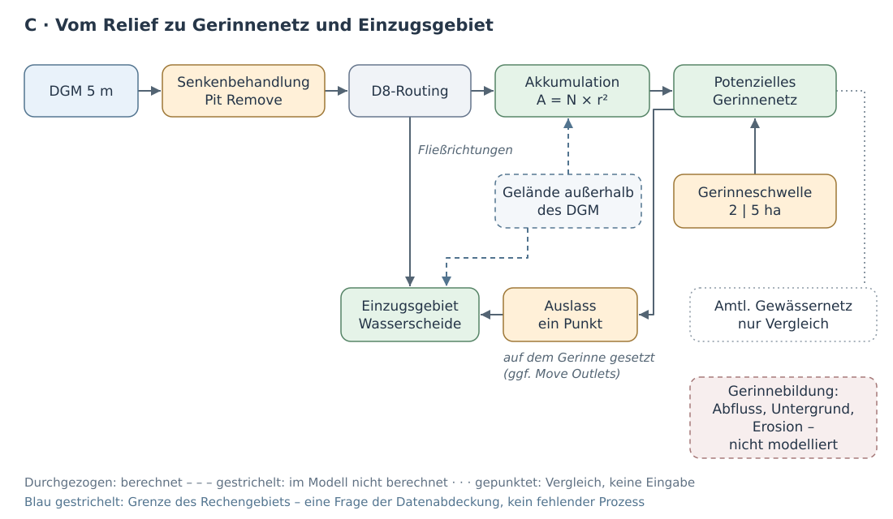
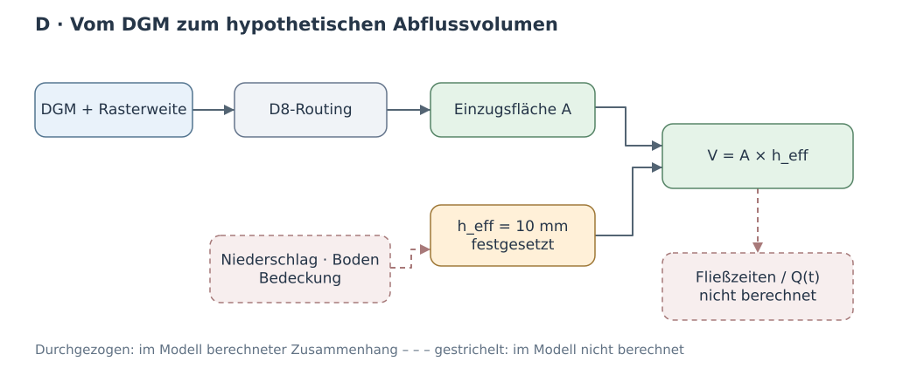
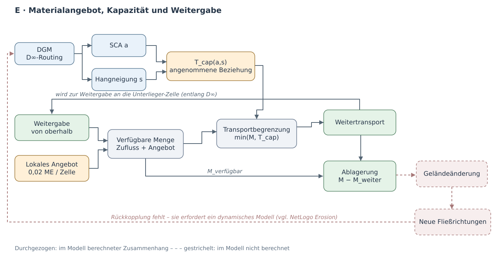

[← Kursübersicht](../index.qmd) · [NetLogo-Vergleich](netlogo_modellvergleich.qmd) · [Modellbildung im GIS](modellbildung_gis_reader.qmd) · [Dokumentation: Daten und Werkzeugfolge](abfluss_algorithmen_quellen.qmd)

## Vom Modellbeispiel zur eigenen Untersuchung

In den bisherigen NetLogo-Modellen waren Gelände und Modellregeln bereits vorgegeben. Wir konnten unmittelbar untersuchen, wie aus lokalen Regeln Abflusswege, Erosion oder veränderte Gerinneformen entstehen.

Bei der eigenständigen Modellierung eines realen Bachabschnitts beginnt die Arbeit früher: **Welcher Teil der Landschaft soll untersucht werden, welche Geodaten stehen dafür zur Verfügung und wie werden daraus geeignete Modelleingaben?** Diese Entscheidungen bestimmen mit, welche Ergebnisse die anschließenden Berechnungen liefern können.

Wir beginnen mit vier bereitgestellten DGM-Kacheln und einem vollständigen, nachvollziehbaren Verarbeitungsweg. Anschließend übertragen Sie dieses Verfahren auf einen selbst gewählten Bachabschnitt. Dabei müssen Sie die erforderlichen Daten selbst beschaffen, aufbereiten und die Eignung Ihres Rechengebiets anhand der Ergebnisse überprüfen.

Auf dieser Grundlage untersuchen Sie, welche Aussagen sich aus dem Relief ableiten lassen und was erst durch zusätzliche Annahmen über Abfluss und Sedimenttransport entsteht. **Zur Modellierung gehört dabei auch die Umsetzung:** Daten in ein berechenbares Raster überführen, Regeln ausführen, Ergebnisse prüfen und nötigenfalls den Ansatz ändern.

## A · Referenzlauf: Vier DGM-Kacheln zu einem Arbeitsraster

### Ausgangsdaten und Datenprüfung

Laden Sie das Archiv [`dgm1_32_49.zip`](https://github.com/gisma-courses/geo-mod-2026/raw/main/assets/mini-data/dgm1_32_49.zip) mit **vier benachbarten DGM1-Kacheln** (je 1 km², zusammen 2 × 2 km) herunter. Entpacken Sie die vier GeoTIFF-Dateien direkt in einen Ordner `mini-data/` in Ihrem Projektordner, ohne zusätzlichen Unterordner. Das Archiv enthält ausschließlich die für diesen Lauf vorgesehenen Kacheln; verwenden Sie diese Originaldateien unverändert.

Öffnen Sie zunächst eine Kachel in QGIS und lesen Sie unter *Layer-Eigenschaften → Information* Koordinatenreferenzsystem (KBS/CRS), Pixelgröße und Ausdehnung ab. Prüfen Sie anhand der Kachelbezeichnungen und ihrer Ausdehnungen, wie die vier Dateien räumlich aneinanderliegen. Machen Sie sich klar, worin der Unterschied zwischen **vier benachbarten Dateien** und **einem einheitlichen Berechnungsraster** besteht.

### Datenaufbereitung

Bei der Arbeit mit realen Geodaten nimmt die **Datenaufbereitung (Data Preparation und Data Cleaning)** häufig einen erheblichen Teil des gesamten Modellierungsaufwands ein – nicht selten mehr als die eigentliche Modellberechnung. Daten müssen beschafft, auf ihre Eignung geprüft, zusammengeführt und in eine einheitliche Struktur gebracht werden. Das ist oft mühsam, aber keineswegs nur technische Vorarbeit: Fehler, Datenlücken oder ungeeignete Transformationen können sämtliche nachfolgenden Modellergebnisse erheblich beeinflussen.

**Entscheidend sind deshalb Transparenz und Reproduzierbarkeit.** Welche Ausgangsdaten wurden verwendet? Welche Veränderungen wurden vorgenommen? Welche Eigenschaften gingen dabei möglicherweise verloren? Ein automatisierter Workflow erleichtert die wiederholbare Verarbeitung, entbindet aber nicht davon, die einzelnen Schritte und ihre Auswirkungen zu verstehen und zu kontrollieren.

Für unsere Übung übernimmt ein eigenes Skript die wiederkehrenden Verarbeitungsschritte. Laden Sie [`scripts/prepare_dgm.py`](../scripts/prepare_dgm.py) über den **QGIS-Processing-Skripteditor** und speichern Sie die Datei dort als Python-Skript. Das Werkzeug erscheint unter **Verarbeitung → Werkzeugkiste → Skripte → Modellieren in der Geographie → DGM vorbereiten: Kacheln mosaikieren und Arbeitsraster erzeugen**.

Die einzelnen Verarbeitungsschritte und verwendeten GDAL-Werkzeuge sind in der [Dokumentation der Werkzeugfolge](abfluss_algorithmen_quellen.qmd) erläutert.

Starten Sie das Werkzeug mit folgenden Eingaben:

| Parameter | Referenzlauf |
|---|---|
| Ordner mit DGM-Kacheln | `mini-data/` |
| Ergebnisordner | `processing/beispiel/` (getrennt von den Quellkacheln) |
| Zellweite des Arbeitsrasters | **5 m** als Voreinstellung; Wert ist frei wählbar |
| Ziel-KBS | Leer lassen, wenn das Quell-KBS bereits projiziert ist und Meter verwendet; für den Burgwald sonst `EPSG:25832` |

Das Werkzeug prüft zunächst die Georeferenzierung der Kacheln und weist u. a. unterschiedliche Quellgitter und überlappende Kacheln zurück. Dann erzeugt es ein **virtuelles Mosaik** und mit GDAL *Warp/Average* ein gemeinsames GeoTIFF. Bei 5 m entstehen:

| Datei | Aufgabe |
|---|---|
| `processing/beispiel/dgm_mosaik.vrt` | Virtuelles Mosaik; verweist weiterhin auf die ursprünglichen Kacheln |
| `processing/beispiel/dgm5.tif` | Eigenständiges, für TauDEM verwendbares 5-m-Arbeitsraster |
| `processing/beispiel/dgm_pruefung.json` | Verarbeitungsparameter, Kacheleigenschaften, gültige/ungültige Zellen und Prüfsummen |

Mit der Zielzellweite entscheiden Sie zugleich, welche Geländeformen im Arbeitsraster noch aufgelöst werden. Diese Detailverluste lassen sich durch das spätere Routing nicht rückgängig machen.

Kontrollieren Sie das erzeugte Arbeitsraster dgm5.tif in QGIS und vergleichen Sie es mit dem Prüfbericht dgm_pruefung.json: Stimmen Koordinatensystem und Zellweite mit den gewählten Einstellungen überein? Sind alle vier DGM-Kacheln enthalten und korrekt zusammengesetzt? Gibt es unerwartete Datenlücken, Überlappungen oder auffällige Übergänge zwischen den Kacheln?

Erst wenn diese Eigenschaften stimmen, verwenden Sie das Raster als Eingabe für TauDEM.

::: {.callout-note collapse="true"}
## Technisch: Was dieses Werkzeug tut

`prepare_dgm.py` beschränkt sich auf die **Rasteraufbereitung**: Es prüft die DGM-Kacheln, erstellt ein virtuelles Mosaik (VRT), erzeugt daraus ein einheitliches GeoTIFF im gewählten Zielraster und dokumentiert die Verarbeitung. Die originalen DGM1-Kacheln bleiben unverändert. Bei der Umrechnung auf die Zielauflösung werden Höhenwerte mittels *Average* gemittelt. Dabei können kleinere NoData-Lücken überdeckt werden. Mit der später notwendigen **hydrologischen Senkenfüllung** hat dieser Effekt nichts zu tun.

**Wichtig für die weitere Verwendung:** Die VRT-Datei enthält keine eigenen Rasterdaten, sondern verweist auf die ursprünglichen Kacheln. Sie bleibt daher nur nutzbar, solange diese Dateien am referenzierten Speicherort verfügbar sind. Das erzeugte GeoTIFF ist dagegen eigenständig.

Das Werkzeug berücksichtigt nur GeoTIFF-Dateien im ausgewählten Ordner, nicht in dessen Unterordnern. Bereits vorhandene Ausgaben werden nicht überschrieben; für einen erneuten Durchlauf verwenden Sie deshalb einen neuen Ergebnisordner.
:::

### Vom Höhenmodell zu berechneten Abflusswegen

Wir haben aus den vier DGM-Kacheln ein zusammenhängendes Höhenraster erzeugt. Es enthält für jede Rasterzelle die Geländehöhe. **Wie lässt sich daraus ableiten, wohin Wasser aufgrund des Geländes fließen würde und wo sich Zuflüsse sammeln?**

Dafür verwenden wir das vorbereitete TauDEM-Werkzeug.

::: {.callout-tip collapse="true"}
## Was ist TauDEM und wie installiere ich es?

**TauDEM (Terrain Analysis Using Digital Elevation Models)** ist eine an der Utah State University entwickelte Sammlung von Werkzeugen zur hydrologischen Geländeanalyse. Aus digitalen Höhenmodellen lassen sich damit unter anderem Fließrichtungen, beitragende Einzugsflächen, potenzielle Gerinnenetze und Wasserscheiden berechnen.

TauDEM ist kein eigenständiges GIS, sondern besteht aus spezialisierten Rechenprogrammen, die einzeln oder in einer Verarbeitungskette ausgeführt werden. Viele dieser Programme können Berechnungen mithilfe von **MPI (Message Passing Interface)** auf mehrere Prozessorprozesse verteilen und somit eine deutlich höhere Verarbeitungsgeschwindigkeit erzeugen.

In unserer Übung übernimmt **QGIS** die Verwaltung, Aufbereitung und Darstellung der Geodaten. Das bereitgestellte Python-Skript verbindet QGIS mit den TauDEM-Programmen und führt die benötigten Berechnungen in festgelegter Reihenfolge aus.

**Wichtig:** TauDEM berechnet hydrologisch relevante Größen aus dem Gelände. Daraus entsteht nicht automatisch eine Simulation tatsächlicher Wasserbewegungen. Welche Aussagen möglich sind, hängt von den gewählten Algorithmen, Eingabedaten und zusätzlichen Modellannahmen ab.

Die [Dokumentation der verwendeten Werkzeuge](abfluss_algorithmen_quellen.qmd) erläutert die einzelnen Berechnungsschritte. Weiterführend: [Offizielle TauDEM-Dokumentation](https://hydrology.usu.edu/taudem/taudem5/documentation.html).

**TauDEM und MPI installieren**

Für die folgenden Berechnungen benötigen Sie **QGIS**, **TauDEM 5.5.0** und **Microsoft MPI**.

1. **QGIS-Processing aktivieren:** Öffnen Sie in QGIS **Erweiterungen → Erweiterungen verwalten und installieren → Installiert**. Suchen Sie nach **Processing** und aktivieren Sie die Erweiterung, falls sie noch nicht eingeschaltet ist. Anschließend steht das Menü **Verarbeitung** mit der Werkzeugkiste zur Verfügung.

2. **TauDEM installieren:** Laden Sie den [offiziellen TauDEM-5.5.0-Komplettinstaller](https://github.com/dtarb/TauDEM/releases/tag/v5.5.0) (`TauDEM550_setup_x64.exe`) herunter und führen Sie ihn aus. Der Komplettinstaller enthält auch Microsoft MPI.

3. **Processing-Skript einbinden:** Öffnen Sie [`taudem_burgwald_processing.py`](../scripts/taudem_burgwald_processing.py) im QGIS-Processing-Skripteditor und speichern Sie es dort. Das Skript wird dadurch beim Skriptanbieter registriert.

4. **Installation prüfen:** Prüfen Sie, ob unter **Verarbeitung → Werkzeugkiste → Skripte → Modellieren in der Geographie** das Werkzeug **TauDEM: Abflusswege, Einzugsgebiet, Wasser, Sediment** erscheint. Starten Sie hier noch keine Berechnung; der erste Lauf ist der anschließende Referenzlauf.

5. **Programmpfade kontrollieren:** Falls TauDEM oder MPI beim Referenzlauf nicht automatisch gefunden werden, geben Sie im Werkzeugdialog das Installationsverzeichnis der TauDEM-Programme und den vollständigen Pfad zu `mpiexec.exe` an.

**Hinweis:** Die bereitgestellten Python-Skripte verwenden den integrierten QGIS-Processing-Skriptanbieter und benötigen kein zusätzliches Plugin. Für die **manuelle Ausführung einzelner TauDEM-Algorithmen** über die QGIS-Werkzeugkiste ist dagegen ein entsprechendes TauDEM-Processing-Provider-Plugin erforderlich.

**Linux:** Die Installation wird in diesem Kurs nicht unterstützt. Für Linux existiert auf Nachfrage eine separate lokale Lösung.


:::

Nach der Installation (siehe Kasten, Schritt 3) finden Sie das Werkzeug unter **Verarbeitung → Werkzeugkiste → Skripte → Modellieren in der Geographie → TauDEM: Abflusswege, Einzugsgebiet, Wasser, Sediment**.

Wählen Sie:

- **Berechnung:** `1 – Grundlage`
- **DGM:** `processing/beispiel/dgm5.tif`
- **Ergebnisordner:** `resultate/beispiel/`

Starten Sie die Berechnung. Lassen Sie die voreingestellte Prüfung auf Randeinflüsse aktiviert.


#### Was hat das Werkzeug berechnet?

Öffnen Sie die folgenden Raster in QGIS und betrachten Sie sie nacheinander:

| Raster | Was zeigt es? |
|---|---|
| `fel.tif` | Das Höhenmodell nach der Behandlung geschlossener Senken. |
| `p.tif` | Für jede Zelle eine kodierte Fließrichtung zu einer ihrer acht Nachbarzellen. |
| `ad8.tif` | Wie viele Rasterzellen über diese Fließverbindungen zu einer bestimmten Zelle beitragen. |
| `src_2ha.tif` | Potenzielle Gerinnelinien ab 2 ha beitragender Fläche. |
| `src_5ha.tif` | Potenzielle Gerinnelinien ab 5 ha beitragender Fläche. |

**Untersuchen Sie zunächst `ad8.tif`.** Die Werte sind auf den Hängen meist klein und werden dort größer, wo viele Fließwege zusammenkommen. Auf diese Weise können sich aus den Geländehöhen verzweigte Abflussnetze ergeben – ohne dass wir zuvor Bäche eingezeichnet haben.

Ein Beispiel: Bei 5 m Rasterweite umfasst jede Zelle 25 m². Steht in `ad8.tif` der Wert 800, tragen nach der D8-Routingregel 800 Zellen zu diesem Punkt bei. Das entspricht einer Fläche von 20.000 m² beziehungsweise 2 ha.

Vergleichen Sie anschließend `src_2ha.tif` und `src_5ha.tif`. Bei der höheren Schwelle erscheinen nur noch diejenigen Abschnitte als Gerinne, an denen mindestens 5 ha beitragen.

**Was verändert sich dadurch – und was nicht?** Werden die Abflussrichtungen neu berechnet oder entscheiden wir lediglich anders, ab welcher beitragenden Fläche wir von einem Gerinne sprechen?

#### Was sagt uns dieser Probelauf?

Wir haben erfolgreich aus Geländehöhen ein räumliches Abflussmodell berechnet. Ob seine Ergebnisse für einen bestimmten Bach sinnvoll sind, wissen wir damit noch nicht.

Unser Beispiel-DGM umfasst 4 km². Wasser, das aus einem Gelände oberhalb dieser vier Kacheln zufließen würde, kann die Berechnung nicht berücksichtigen. Die Modellgrenze ist also zunächst eine Grenze unserer Daten, nicht zwangsläufig eine natürliche Wasserscheide.

Für die anschließende Untersuchung eines realen Bachs müssen wir deshalb prüfen, ob unser DGM auch das Gelände oberhalb des gewählten Auslasses vollständig abdeckt, aus dem Wasser zufließen kann.

## B · Den Workflow auf ein eigenes Untersuchungsgebiet übertragen

Im ersten Teil haben Sie vier bereitgestellte DGM-Kacheln zu einem einheitlichen Höhenraster verarbeitet. Nun wenden Sie denselben Workflow auf selbst beschaffte Geodaten an.

### 1 · Untersuchungsgebiet und Daten auswählen

Wählen Sie einen kleinen Bachoberlauf in Hessen und einen Betrachtungsraum von ungefähr 2 × 2 km.

Beschaffen Sie die benötigten DGM1-Kacheln über das [Geodatenportal Hessen](https://gds.hessen.de/). Achten Sie darauf, dass auch das Gelände oberhalb des gewählten Bachabschnitts berücksichtigt wird. Ein rechteckiger Kartenausschnitt entspricht nicht automatisch einem vollständigen hydrologischen Einzugsgebiet.

Bewahren Sie die Originaldaten unverändert auf.

### 2 · DGM selbstständig aufbereiten

Verwenden Sie das bereits kennengelernte QGIS-Werkzeug **Modellieren in der Geographie → DGM vorbereiten**.

Wählen Sie Ihre eigenen DGM-Kacheln und einen neuen Ausgabeordner `processing/myBurgwald/`. Behalten Sie zunächst die Zielauflösung von **5 m** bei.

Prüfen Sie anhand des erzeugten Rasters und des Prüfberichts, ob Koordinatensystem, Pixelgröße, räumliche Abdeckung und Kachelanschlüsse plausibel sind.

### 3 · Ist der gewählte DGM-Ausschnitt geeignet?

Laden Sie Ihr aufbereitetes DGM in QGIS und ergänzen Sie als unabhängige
Referenz das [amtliche Gewässernetz Hessen (DLM25)](https://www.geoportal.hessen.de/spatial-objects/262).

Die Gewässerlinien dienen zum visuellen Vergleich mit den berechneten Abflusswegen; sie gehen nicht in die TauDEM-Berechnung ein.

::: {.callout-note collapse="true"}
## Technisch: Amtliches Gewässernetz über WFS in QGIS einbinden

Das Hessische Landesamt für Naturschutz, Umwelt und Geologie (HLNUG) stellt das Gewässernetz `Gewaessernetz_DLM25` als **Web Feature Service (WFS)** bereit. Darüber können Sie die Gewässerlinien direkt in QGIS laden, ohne einen vollständigen Datensatz herunterladen zu müssen.

1. Öffnen Sie in QGIS **Layer → Layer hinzufügen → WFS/OGC API Features-Layer hinzufügen**.
2. Klicken Sie auf **Neu**, um eine Verbindung anzulegen.
3. Tragen Sie folgende Angaben ein:
   - **Name:** `HLNUG Gewässernetz Hessen`
   - **URL:**
     `https://geodienste-umwelt.hessen.de/arcgis/services/inspire/gewaessernetz/MapServer/WFSServer?`
4. Bestätigen Sie mit **OK** und klicken Sie anschließend auf **Verbinden**.
5. Wählen Sie den Layer `inspire_gewaessernetz:Gewaessernetz_DLM25` und klicken Sie auf **Hinzufügen**.

Die Gewässerlinien erscheinen nun als Vektorlayer in QGIS. Stellen Sie den Kartenausschnitt auf Ihr Untersuchungsgebiet ein.

**Daten lokal speichern:** Für eine reproduzierbare Bearbeitung empfiehlt es sich, die benötigten Gewässerlinien als GeoPackage zu sichern. Klicken Sie mit der rechten Maustaste auf den Layer und wählen Sie **Exportieren → Objekte speichern als …**. Wählen Sie das Format **GeoPackage**, begrenzen Sie die Ausgabe bei Bedarf auf Ihren Untersuchungsraum und speichern Sie die Datei beispielsweise unter `data/gewaessernetz.gpkg`.

Der WFS stellt tatsächliche Liniengeometrien und Attribute bereit, nicht nur ein Kartenbild. Die Gewässerlinien dienen als **unabhängige Referenz** für den späteren Vergleich mit den berechneten Abflusswegen. Sie gehen nicht in das TauDEM-Routing ein.

**Datenquelle:** [HLNUG – Gewässernetz Hessen, Geoportal](https://www.geoportal.hessen.de/spatial-objects/262), Lizenz CC BY 4.0.
:::

Laden Sie Ihr aufbereitetes DGM zusammen mit den amtlichen Gewässerlinien in QGIS. Suchen Sie den Bachabschnitt, den Sie untersuchen möchten, und verfolgen Sie den kartierten Bach sowie seine Zuflüsse **flussaufwärts**.

**Verlassen der Bach oder einer seiner Zuflüsse das DGM am oberen Rand?** Dann fehlen offensichtlich Geländedaten für die spätere Berechnung. Ergänzen Sie die entsprechenden DGM-Kacheln.

Diese erste Prüfung erkennt jedoch nur offensichtliche Lücken. Zuflüsse über die umliegenden Hänge lassen sich aus der Gewässerkarte allein nicht zuverlässig erfassen.

**Die Wahl des Rechengebiets ist deshalb ein iterativer, explorativer Prozess:** Wir beginnen mit einem begründeten Ausschnitt, berechnen Abflusswege und Einzugsgebiete und überprüfen anschließend, ob die Modellgrenzen das Ergebnis beeinflussen. Gegebenenfalls erweitern wir das DGM und wiederholen die Berechnung. Die Prüfung dafür folgt in Teil C (*Pflichtkontrolle*).

Alternativ könnten wir von Anfang an ein sehr großes Gebiet berechnen, das mit hoher Wahrscheinlichkeit sämtliche relevanten Zuflüsse umfasst. Das erfordert jedoch erheblich mehr Geodaten und Rechenaufwand.

Für unsere Übung wählen wir bewusst den **iterativen Weg**: Die Frage nach der notwendigen räumlichen Ausdehnung wird damit selbst zu einem Teil der Modellierung.


## C · Was folgt allein aus dem Gelände?

Im ersten Rechenschritt verwenden wir nur das aufbereitete Höhenraster. 
TauDEM berechnet daraus Fließrichtungen und beitragende Flächen. 
So lässt sich untersuchen, wo sich Abfluss im Gelände bündelt und 
welche Flächen zu einem gewählten Auslass entwässern.

{width="100%"}


::: {.callout-warning title="Wichtig" collapse="false"}
Die Datenaufbereitung aus Teil A/B **muss abgeschlossen** sein, bevor Sie mit der hier dargestellten Modellkette beginnen.
:::

### Entwässerungsverbindungen und Flächenakkumulation


Öffnen Sie **Verarbeitung → Werkzeugkiste → Skripte → Modellieren in der Geographie → TauDEM: Abflusswege, Einzugsgebiet, Wasser, Sediment**. Wählen Sie **Berechnung 1 – Grundlage** mit

- **DGM:** `processing/myBurgwald/dgm5.tif`
- **Ergebnisordner:** `resultate/myBurgwald/`

Verwenden Sie diesen Ergebnisordner auch für die Berechnungen 2–4, denn das Skript sucht dort die bereits erzeugten Routingraster. Die erste Modellregel wird nun als Berechnung umgesetzt: Relief für das Routing vorbereiten, D8-Fließrichtungen bestimmen und Beiträge entlang dieser Verbindungen aufsummieren. Das Skript führt dazu auf Ihr eigenes Arbeitsraster folgende TauDEM-Schritte aus:

| TauDEM-Werkzeug | Eingabe → Ausgabe | Bedeutung des Ergebnisses |
|---|---|---|
| **Pit Remove** | `dgm5.tif` → `fel.tif` | Für den Abfluss aufbereitete Höhenwerte, weiterhin **m** |
| **D8 Flow Directions** | `fel.tif` → `p.tif`, `sd8.tif` | `p`: kodierte Richtung zu **einem** Nachbarn; `sd8`: Gefälle **m/m** |
| **D8 Contributing Area** | `p.tif` → `ad8.tif` | Anzahl der zu einer Zelle entwässernden Zellen einschließlich der Zelle selbst |

Das Skript ruft dafür `PitRemove`, `D8FlowDir` und `AreaD8` auf. Lassen Sie die **Prüfung auf Randeinflüsse aktiviert** und setzen Sie keine Auslasspunkte als Einschränkung. Stellen Sie `ad8.tif` mit logarithmischer Farbskala oder mehreren abgestuften Klassen dar: Die großen Werte markieren die **potenziellen Konzentrationslinien** im Relief. Prüfen Sie außerdem mit dem Rasterrechner `"fel@1" - "dgm5@1"` an mindestens einer Vertiefung, **wo das Senkenfüllen Höhen verändert hat**. Ein Wert von `0` bedeutet: unverändert.

Die [Werkzeugdokumentation](abfluss_algorithmen_quellen.qmd) führt die vollständige Abfolge aller vier TauDEM-Modi mit Eingaben, Parametern, Ausgaben und Kontrollen auf.

**Lesen Sie den Wert an einer Zelle der Talrinne ab.** Das D8-Akkumulationsraster gibt die Anzahl der beitragenden Rasterzellen an. Multipliziert mit der Zellfläche ergibt sich die beitragende Einzugsfläche:

$$
A_{\mathrm{D8}} = N_{\mathrm{D8}} \cdot \Delta x \cdot \Delta y
$$

Dabei ist $N_{\mathrm{D8}}$ die Anzahl beitragender Zellen und $\Delta x$, $\Delta y$ sind die Zellabmessungen in Metern. Für quadratische Rasterzellen mit der Zellweite $r$ vereinfacht sich die Gleichung zu:

$$
A_{\mathrm{D8}} = N_{\mathrm{D8}} \cdot r^2
$$

Bei einer Zellweite von 5 m entspricht jede Zelle einer Fläche von 25 m².

Beispiel: `ad8 = 4000` bedeutet **100 000 m² = 10 ha** beitragende Fläche – **nicht** 4 000 Liter, 4 000 m³/s oder 4 000 tatsächlich dort eintreffende Regentropfen.

::: {.callout-tip collapse="true"}
## Kurzreader Fachwissen: Routing und Akkumulation

**Routing** legt für jede Zelle fest, **wohin** ein Beitrag weitergegeben wird. **Akkumulation** zählt bzw. summiert anschließend, **was von oberhalb ankommt**. Bei D8 stehen im Raster `p.tif` nur Richtungs**codes** (acht mögliche Nachbarn), in `ad8.tif` dagegen **Zellanzahlen**. Die Zahl `4000` ist nicht die vierte Fließrichtung, sondern 4000 vollständig verbundene Zellen einschließlich der Zielzelle. Erst die Multiplikation mit der Zellfläche erzeugt eine Fläche in m².

An einer Wasserscheide sind Zuflüsse von der jeweils anderen Seite **nicht** angeschlossen. Umgekehrt können am Auslass viele Hangzellen zusammenkommen. Beides ergibt sich aus denselben Richtungsverbindungen; die Akkumulation stellt deshalb keine neue Fließregel dar.
:::

::: {.callout-tip collapse="true"}
## Fachliche Erweiterung: Rasterweite gezielt testen

Wiederholen Sie die DGM-Vorbereitung aus denselben Quellkacheln mit **10 m** Zielzellweite in einem neuen Ergebnisordner und wiederholen Sie `Pit Remove` → D8 → `AreaD8`. Vergleichen Sie am **gleichen realen Auslass** Gerinnelage und Einzugsgebietsfläche in **m²**, nicht die Zellzahlen. Verwenden Sie für 2 ha als Gerinneschwelle nun **200 Zellen**. Unterscheiden Sie Änderungen durch **Generalisation des Reliefs** von den rein rechnerischen Folgen einer größeren Zellfläche.
:::

::: {.callout-tip collapse="true"}
## Fachlich: Was bei der Senkenbehandlung verändert wird

`Pit Remove` hebt geschlossene Vertiefungen bis zum niedrigsten Überlaufniveau an, damit eine zusammenhängende Abflussverbindung entstehen kann. Das ist für das Relief-Routing zweckmäßig, aber **keine Beobachtung eines aufgefüllten Geländes**. Echte Senken, Straßendämme, Brücken und Durchlässe können andere Regeln erfordern. Prüfen Sie eine auffällige Abweichung zwischen kartiertem Bach und berechnetem Weg zunächst im **ursprünglichen** DGM, nicht erst durch weiteres Glätten.
:::

::: {.callout-note collapse="true"}
## Technisch: Fehler eingrenzen statt Rechenregeln verändern

Falls TauDEM abbricht, lesen Sie im QGIS-Processing-Protokoll zuerst den fehlgeschlagenen Befehl und seine Eingaben. Prüfen Sie Dateipfade, das gewählte TauDEM-Binärverzeichnis, den MPI-Launcher und das Koordinatensystem. Die Quellkacheln dürfen nicht direkt als Ersatz für `dgm5.tif` eingesetzt werden.

Bei unklaren Aufrufen oder Fehlermeldungen können Sie technische Dokumentation und KI-Unterstützung nutzen; maßgeblich bleiben der tatsächlich ausgeführte Befehl, die Softwareversion und das überprüfte Ergebnis. Eine Änderung an Zellweite, Senkenbehandlung oder Randeinflussprüfung ist **keine** bloße technische Reparatur, sondern verändert gegebenenfalls die Modellannahme.
:::


### Gerinneschwelle, Auslass und Einzugsgebiet

Aus `p.tif` kennen wir die D8-Fließrichtung jeder Rasterzelle; `ad8.tif` zählt die Zellen, deren Fließwege an einem bestimmten Punkt zusammenlaufen. Dadurch werden Konzentrationslinien im Relief sichtbar. **Ein Gewässernetz ist damit noch nicht abgegrenzt.**

Ein *Gerinne* ist eine räumlich begrenzte Abflussbahn. Ob sich dort tatsächlich ein Bachbett bildet, hängt unter anderem von Abfluss, Gefälle, Untergrund und Erosion ab. Diese Entstehungsprozesse berechnet unser Routing nicht. Für die Darstellung eines **potenziellen Gerinnenetzes** treffen wir deshalb eine einfache Annahme: Eine Rasterzelle zählt als Gerinne, sobald ihre beitragende Fläche einen festgelegten Schwellenwert erreicht.

{width="100%"}

#### Gerinneschwelle: Was wird zum Gewässernetz gezählt?

Das TauDEM-Werkzeug *Stream Definition By Threshold* hat in Berechnung 1 bereits zwei Raster erzeugt:

- `src_2ha.tif`: potenzielle Gerinne ab **2 ha** beitragender Fläche;
- `src_5ha.tif`: potenzielle Gerinne ab **5 ha** beitragender Fläche.

Die Gerinnezellen tragen den Wert `1`, die übrigen gültigen Zellen `0`. Bei der hier verwendeten Zellweite von 5 m entsprechen 2 ha **800 Zellen** und 5 ha **2 000 Zellen**. Bei anderer Zellweite wird die erforderliche Zellzahl entsprechend der tatsächlichen Zellfläche berechnet.

Stellen Sie beide Raster nacheinander dar (Wert `0` möglichst transparent). **Wo beginnen die modellierten Gerinne? Welche Oberläufe und Verzweigungen entfallen bei 5 ha?** Suchen Sie einen Abschnitt, an dem der Unterschied besonders deutlich ist.

Die Schwelle ist eine **Klassifikationsregel**, keine Naturkonstante: Sie ändert, welche Zellen wir als Gerinne bezeichnen, **nicht** die D8-Fließrichtungen in `p.tif` oder die Akkumulation in `ad8.tif`.

#### Auslass: Welches Gelände entwässert zu *diesem* Punkt?

Für einen bestimmten Bachabschnitt interessiert uns nicht das gesamte Gerinnenetz, sondern die Fläche, deren D8-Fließwege an **einem gewählten Punkt** zusammenlaufen. Diesen Punkt nennen wir *Auslass*; die zu ihm entwässernden Zellen bilden sein *Einzugsgebiet*. Dessen äußerer Rand ist die berechnete *Wasserscheide*.

1. **Auslass setzen:** Wählen Sie auf `src_2ha.tif` eine Gerinnezelle Ihres eigenen Bachs. Erstellen Sie über **Layer → Layer erstellen → Neuer GeoPackage-Layer** einen Punktlayer `data/auslass.gpkg` im KBS des DGM mit dem ganzzahligen Feld `id`. Speichern Sie genau **einen** Punkt mit `id = 1` auf dieser Zelle. Maßgeblich ist die berechnete Gerinnezelle, nicht allein die optische Lage auf der amtlichen Gewässerlinie. Verwenden Sie einen gespeicherten, ungefilterten Layer.
2. **Einzugsgebiet berechnen:** Öffnen Sie das TauDEM-Processing-Skript, wählen Sie **Berechnung 2 – Einzugsgebiet**, den Auslasslayer, den Ergebnisordner `resultate/myBurgwald/` und zunächst **Verschieben = 0**. *Gage Watershed* verfolgt dazu die Verbindungen aus `p.tif` rückwärts und schreibt `becken.tif`.
3. **Abgrenzung prüfen:** Stellen Sie `becken.tif` zusammen mit `ad8.tif` dar. Die Rasterzellen mit `id = 1` gehören zum Einzugsgebiet. Bestimmen Sie ihre Anzahl und Fläche und vergleichen Sie die Zellanzahl mit dem Wert von `ad8.tif` **an derselben Auslasszelle**. Bei gültigen D8-Werten und übereinstimmender Auslassposition sollten beide Anzahlen gleich sein.

Für *Gage Watershed* sind die D8-Fließrichtungen und die Auslassposition entscheidend, **nicht** die zuvor gewählte Gerinneschwelle. Diese hilft lediglich dabei, einen Auslass auf einem berechneten Fließweg zu platzieren.

::: {.callout-note collapse="true"}
## Technisch: Wenn der Auslass neben dem berechneten Gerinne liegt

In **Berechnung 2** können Sie **„Auslass maximal um N Zellen verschieben“** einstellen. TauDEM *Move Outlets To Streams* sucht dann entlang der D8-Verbindung eine Gerinnezelle (standardmäßig aus `src_2ha.tif`). Bei `N = 2` sind höchstens zwei D8-Schritte erlaubt; bei 5-m-Zellen sind das je nach Richtung bis etwa 14,1 m.

Kontrollieren Sie die tatsächliche Position in `auslass_auf_gerinne.shp` und den Wert `dist_moved`. Bei `-1` wurde kein geeignetes Gerinne erreicht; wählen Sie dann den Auslass selbst neu. Verwenden Sie für den Vergleich von Einzugsgebieten immer die **tatsächlich verwendete** Auslassposition.
:::

#### Pflichtkontrolle: Reicht unser DGM für diesen Auslass aus?

Ein aus `becken.tif` abgegrenztes Gebiet ist noch kein Nachweis dafür, dass **alle** oberhalb liegenden Zuflüsse erfasst wurden. Das Modell kennt nur das Relief innerhalb des vorliegenden DGM. Kontrollieren Sie deshalb **vor der Interpretation der Einzugsgebietsfläche**:

1. **Lage zum Rasterrand:** Berührt das berechnete Einzugsgebiet den Rand des DGM? Prüfen Sie dann, ob mögliche Oberlieger außerhalb der verfügbaren Daten liegen.
2. **NoData und Randeinflussprüfung:** Treten auf den relevanten Zuflusswegen in `ad8.tif` NoData-Werte auf? TauDEM kann damit bei aktivierter Randeinflussprüfung unvollständige Zuflüsse anzeigen; NoData kann allerdings auch durch Lücken der Eingangsdaten entstehen. Beides muss unterschieden werden.
3. **Rechenkonsistenz:** Stimmt die Anzahl der Zellen in `becken.tif` mit `ad8.tif` am Auslass überein? Eine Übereinstimmung bestätigt die interne D8-Zuordnung, **nicht** automatisch die Vollständigkeit des DGM.

Bei Hinweisen auf abgeschnittene Zuflüsse erweitern Sie den Kachelbestand, erstellen das Arbeitsraster erneut und wiederholen die Berechnung für **denselben geografischen Auslass**. Vergleichen Sie die beiden Einzugsgebietsflächen und Akkumulationswerte. Eine bloße Deaktivierung der Randeinflussprüfung löst das Datenproblem nicht.

#### Berechnete Fließwege mit dem kartierten Bach vergleichen

Gehen Sie zu einer Stelle, an der `src_2ha.tif` oder `src_5ha.tif` von der amtlichen Gewässerlinie abweicht. **Wo** tritt die Abweichung auf, und **welcher Befund** lässt sich im ursprünglichen DGM dazu finden? Kommen beispielsweise die Rasterauflösung, die Senkenbehandlung oder die D8-Richtungswahl als Erklärung infrage? Berücksichtigen Sie auch die Lagegenauigkeit und Generalisierung der amtlichen Gewässerreferenz. Sie ist unabhängig vom Routing, aber nicht fehlerfrei.

Die Routingrechnung nutzt die **vorhandene Geländeform**. Eine bereits vorhandene Bachkrümmung kann daher im berechneten Verlauf erscheinen; ihre Entstehung durch Ufererosion wird hier nicht simuliert.

### D8 und D∞: Zwei Regeln für dasselbe Gelände

Bisher haben wir mit **D8** gearbeitet: Der gesamte Beitrag einer Zelle wird einem ihrer acht Nachbarn zugewiesen. Auf breiten Hängen kann diese Festlegung schmale, stark konzentrierte Fließlinien erzeugen. **D∞ (D-Infinity)** bestimmt dagegen einen kontinuierlichen Fließwinkel aus dem Relief und verteilt den Beitrag – je nach Winkel – anteilig auf höchstens zwei Nachbarzellen. Es handelt sich also nicht einfach um dieselbe Berechnung mit einer anderen Darstellung.

{width="100%"}

Die gezeigte Aufteilung 60/40 ist illustrativ, kein festes TauDEM-Verhältnis. Bei klassischem *Multiple Flow Direction* (MFD) kann ein Beitrag auch auf mehr als zwei Nachbarn verteilt werden. [Tarboton (1997)](https://doi.org/10.1029/96WR03137) beschreibt das D∞-Verfahren.

Berechnung 1 hat beide Routingvarianten bereits aus **demselben senkenbehandelten Raster `fel.tif`** erzeugt:

| Ausgabe | Berechnung | Bedeutung |
|---|---|---|
| `p.tif`, `ad8.tif` | D8-Richtungen und *D8 Contributing Area* | Richtungskennungen und Anzahl vollständig beitragender Zellen |
| `ang.tif`, `slp.tif` | *D-Infinity Flow Directions* | Kontinuierlicher Fließwinkel (rad) und Hangneigung (m/m) |
| `sca.tif` | *D-Infinity Contributing Area* | Spezifische beitragende Fläche (*SCA*, m²/m = m) |
| `twi.tif` | *Topographic Wetness Index* | Aus SCA und Hangneigung abgeleiteter Index |

**Vergleichen Sie `ad8.tif` und `sca.tif`** auf einer Hangfläche und entlang des Talzugs. Welche Strukturen erscheinen scharf gebündelt, welche breiter verteilt? Vergleichen Sie zunächst die **räumlichen Muster**, nicht die Zahlenwerte: `ad8` zählt Zellen, `sca` gibt einen Flächenbeitrag bezogen auf eine Breite an. Der Mustervergleich allein trennt zudem den Einfluss der Routingregel nicht vollständig von dem der unterschiedlichen Bezugsgrößen.

#### Was bedeuten SCA und TWI?

Die *Specific Catchment Area* (`sca.tif`) verteilt die von oberhalb kommenden Flächenbeiträge nach D∞ und bezieht sie auf eine Breite. Für quadratische Zellen mit Zellweite $r$ gilt schematisch:

$$
a = \frac{A_{\mathrm{eff}}}{r}, \qquad [a] = \mathrm{m}.
$$

Bei **5 m** Zellweite entspricht `sca = 30` einer effektiven beitragenden Fläche von rechnerisch **150 m²** je 5 m Bezugsbreite – nicht 30 vollständig beitragenden Rasterzellen.

{width="100%"}

Der *Topographic Wetness Index* (`twi.tif`) verknüpft diese spezifische Fläche mit der Hangneigung:

$$
\mathrm{TWI} = \ln\!\left(\frac{a}{\tan\beta}\right).
$$

Bei vergleichbarer Neigung führt eine größere SCA zu höheren Indexwerten; bei vergleichbarer SCA führt ein geringeres Gefälle zu höheren Werten. **Zeigen Sie die höchsten Werte in `twi.tif`: Liegen sie an steilen Hängen oder in flacheren, zuflussreichen Bereichen?** Der Index beschreibt eine modellierte topografische Feuchte-Disposition, **keine gemessene Bodenfeuchte**. Die Behandlung sehr geringer Neigungen beeinflusst das Ergebnis.

{width="100%"}

Hintergrund: [Beven & Kirkby (1979)](https://doi.org/10.1080/02626667909491834). Die [Dokumentation der verwendeten Werkzeugfolge](abfluss_algorithmen_quellen.qmd) zeigt die konkreten TauDEM-Aufrufe mit Eingaben und Ausgaben.

## D · Von der Einzugsfläche zur hypothetischen Abflussmenge

Bisher beschreibt unsere D8-Akkumulation, **wie viele Rasterzellen zu einem bestimmten Punkt entwässern**. Daraus lässt sich die beitragende Einzugsfläche berechnen. Über die tatsächlich anfallende Wassermenge sagt diese Fläche allein jedoch nichts aus.

Dazu benötigen wir eine zusätzliche Annahme über die **Abflussbildung**: Wie viel Wasser liefert jede Fläche überhaupt an das berechnete Entwässerungsnetz?

### Ein einheitlicher Abflussbeitrag

Wir nehmen zunächst an, dass jede Rasterzelle während eines gedachten Niederschlagsereignisses **10 mm effektiven Abfluss** liefert. Gemeint ist der Niederschlagsüberschuss nach Abzug sämtlicher Verluste, nicht die gesamte Niederschlagsmenge.

Damit ergibt sich für jede Zelle ein Beitrag von

$$
V_{\mathrm{Zelle}} = A_{\mathrm{Zelle}} \cdot h_{\mathrm{eff}}
$$

und für einen beliebigen Punkt im D8-Netz:

$$
V = N_{\mathrm{D8}} \cdot A_{\mathrm{Zelle}} \cdot h_{\mathrm{eff}}
$$

Dabei ist $N_{\mathrm{D8}}$ die Anzahl der beitragenden Zellen aus `ad8.tif`, $A_{\mathrm{Zelle}}$ deren Fläche in m² und $h_{\mathrm{eff}}$ die angenommene effektive Abflusshöhe in Metern.

**Berechnen Sie das hypothetische Abflussvolumen für Ihr Untersuchungsgebiet.** Öffnen Sie den QGIS-Rasterrechner und verwenden Sie bei einer Zellweite von 5 m:

```text
"ad8@1" * 25 * 0.010
```

Der Rasterausdruck setzt die Modellgleichung unmittelbar um: `ad8` liefert die beitragende Zellanzahl, `25` die Fläche einer 5-m-Zelle und `0.010` die angenommene effektive Abflusshöhe. Die Zellfläche muss zum Arbeitsraster passen; die Abflusshöhe ist dagegen eine zusätzliche Modellannahme.

Speichern Sie das Ergebnis als `resultate/myBurgwald/volumen_10mm.tif`. Bei anderen Rasterweiten muss die Zellfläche entsprechend angepasst werden.

Lesen Sie den Wert an Ihrem zuvor festgelegten Auslass ab und rechnen Sie ihn mit der dort ermittelten Einzugsgebietsfläche von Hand nach. Für beispielsweise 800 beitragende Zellen zu je 25 m² ergeben sich:

$$
V = 800 \cdot 25\,\mathrm{m}^2 \cdot 0{,}010\,\mathrm{m}
  = 200\,\mathrm{m}^3
$$

**Was haben wir mit dieser Rechnung gewonnen?** Wir können der beitragenden Fläche unter einer gesetzten Abflussannahme ein Wasservolumen zuordnen. Die räumlichen Muster bleiben dabei unverändert: Wo sich zuvor viele beitragende Zellen konzentrierten, entstehen nun große Volumenwerte. Weder die Fließrichtungen noch die Verteilung der Abflussbildung wurden neu bestimmt.

Auch die zeitliche Verteilung bleibt unbekannt. Aus 200 m³ Gesamtvolumen lässt sich ohne weitere Annahmen kein Spitzenabfluss in m³/s ableiten.

{width="77%"}

### Was wäre bei räumlich unterschiedlichen Abflussbeiträgen?

Unsere bisherige Rechnung unterstellt, dass Waldflächen, versiegelte Flächen und andere Oberflächen denselben effektiven Abfluss liefern. Für ein reales Niederschlagsereignis ist das im Allgemeinen nicht plausibel.

Ein nächster Modellierungsschritt könnte daher jeder Zelle einen eigenen Abflussbeitrag zuweisen, beispielsweise nach dem vereinfachten Ansatz

$$
V_i = P \cdot C_i \cdot A_i
$$

mit Niederschlagshöhe $P$, einem räumlich variierenden Abflussbeiwert $C_i$ und der Zellfläche $A_i$.

Dafür reichen die bisherigen Geländedaten nicht mehr aus. Wir benötigen zusätzliche Informationen über die Flächeneigenschaften und begründete Annahmen darüber, wie diese die Abflussbildung beeinflussen. Eine ATKIS-Landnutzungsklasse liefert beispielsweise noch keinen unmittelbar gültigen Abflussbeiwert.

**Erst hier wird die gewichtete Akkumulation relevant:** Statt überall denselben Zellbeitrag anzunehmen, summiert TauDEM die räumlich unterschiedlichen Beiträge entlang der bereits berechneten D8-Fließverbindungen.

Das vorhandene Processing-Skript bietet dafür **Berechnung 3 – gewichtete Abflussakkumulation**. Es benötigt ein Raster `runoff_zelle_m3.tif`, das den *lokalen* Abflussbeitrag jeder einzelnen Zelle enthält. Dieses muss hinsichtlich Zellweite, Ausdehnung und Rasterausrichtung zum Routingraster passen. Die Ausgabe `volumen_gewichtet_m3.tif` enthält dann die aufsummierten Beiträge.

Würden wir jeder 5-m-Zelle erneut konstant 0,25 m³ zuweisen, müsste die gewichtete Akkumulation dasselbe Ergebnis liefern wie unsere erste Volumenrechnung. **Der zusätzliche Algorithmus schafft also nicht von sich aus mehr hydrologische Information. Entscheidend ist, welche räumlich differenzierten Eingaben wir ihm geben und wie wir diese begründen.**

## E · Was ändert sich durch eine Transportgrenze?

Bisher haben wir berechnet, wie sich Flächen- oder Mengenbeiträge entlang eines Entwässerungsnetzes ansammeln. Dabei wurde angenommen, dass die Beiträge ohne Einschränkung weitergeleitet werden.

Für den Transport von Material ist das keine ausreichende Beschreibung. Wasser kann beispielsweise Sediment mitführen, seine Transportfähigkeit hängt aber unter anderem von den Strömungsverhältnissen ab. **Was geschieht, wenn an einer Stelle mehr Material ankommt, als weitertransportiert werden kann?**

Wir untersuchen diese Frage mit einem vereinfachten Modell, das zwei Größen unterscheidet:

- **Materialangebot:** Wie viel Material wird in einer Zelle zusätzlich bereitgestellt?
- **Transportkapazität:** Wie viel Material kann die Zelle insgesamt an die nächsten Zellen weitergeben?

Das ankommende Material wird zum lokalen Angebot addiert. Übersteigt die verfügbare Menge die Transportkapazität, verbleibt der Überschuss als Ablagerung.

{width="100%"}

Die zugehörige Bilanz lautet:

$$
\begin{aligned}
M_{\mathrm{verfügbar}} &= M_{\mathrm{von\ oben}} + M_{\mathrm{lokal}},\\
M_{\mathrm{weiter}} &= \min(M_{\mathrm{verfügbar}},T_{\mathrm{cap}}),\\
M_{\mathrm{abgelagert}} &= M_{\mathrm{verfügbar}}-M_{\mathrm{weiter}}.
\end{aligned}
$$

TauDEM setzt diese Regel mit *D-Infinity Transport Limited Accumulation* entlang der bereits berechneten D∞-Fließverbindungen um. Anders als bei der D8-Akkumulation können die weitergegebenen Beiträge dabei auf zwei Nachbarzellen verteilt werden.

### 1 · Materialangebot und Transportkapazität festlegen

Für unser Untersuchungsgebiet liegen weder gemessene Erosionsraten noch geeignete Sedimenttransportparameter vor. Deshalb verwenden wir **synthetische Materialeinheiten (ME)**. Sie beziehen sich auf einen gemeinsamen gedachten Bilanzfall, nicht auf eine reale Zeitspanne.

Wir treffen zwei Annahmen:

**Materialangebot:** Jede gültige Rasterzelle stellt zusätzlich `0,02 ME` bereit, unabhängig von ihrer Lage.

**Transportkapazität:** Zellen mit größerer spezifischer beitragender Fläche (`sca`) und höherem Gefälle (`slp`) dürfen mehr Material weitergeben. Dafür setzen wir folgende Modellbeziehung an:

$$
T_{\mathrm{cap}}
= 0{,}2\,\mathrm{ME}
\cdot\sqrt{\frac{a}{5\,\mathrm{m}}}
\cdot\frac{s+0{,}0001}{0{,}05}
$$

Dabei ist $a$ die spezifische beitragende Fläche in Metern und $s$ die dimensionslose Hangneigung. Die Bezugsgrößen von 5 m und 0,05 machen die beiden Quotienten dimensionslos.

**Diese Beziehung ist eine Versuchsannahme, kein empirisch kalibriertes Sedimenttransportgesetz.** Der Faktor `0,2 ME`, die Bezugsgrößen und der kleine Gefällezusatz sind frei gesetzte Parameter. Die 5 m im Ausdruck sind eine feste Bezugsbreite und nicht automatisch die jeweils eingestellte Rasterweite. Der kleine Gefällezusatz `0.0001` verhindert, dass die Transportkapazität bei einem Gefälle von null ebenfalls null wird. Er ermöglicht damit einen geringen Weitertransport auch auf rechnerisch ebenen Zellen. Das ist keine numerische Notwendigkeit, sondern eine zusätzliche Modellannahme, deren Wirkung insbesondere bei sehr kleinen Gefällen relevant wird.

Erzeugen Sie im QGIS-Rasterrechner die beiden Eingaberaster:

| Raster | Ausdruck |
|---|---|
| `processing/angebot.tif` | `("dgm5@1" * 0) + 0.02` |
| `processing/kapazitaet.tif` | `0.2 * sqrt("sca@1" / 5) * (("slp@1" + 0.0001) / 0.05)` |

Beide Raster müssen auf demselben Rastergitter wie `ang.tif` liegen. Überprüfen Sie Zellweite, Rasterausrichtung, Ausdehnung und NoData-Bereiche.

Das Angebot ist als Menge **pro Rasterzelle** festgelegt. Bei einem Vergleich unterschiedlicher Rasterweiten wäre deshalb auch diese Annahme anzupassen.

### 2 · Transport und Ablagerung berechnen

Starten Sie das bereitgestellte TauDEM-Processing-Skript mit **Berechnung 4 – Transport und Ablagerung**.

Verwenden Sie:

- **Materialangebot:** `processing/angebot.tif`
- **Transportkapazität:** `processing/kapazitaet.tif`
- **Ergebnisordner:** `resultate/myBurgwald/`
- **Ausgabesuffix:** zunächst leer

Das Skript ruft *DinfTransLimAccum* mit den vorhandenen D∞-Fließrichtungen (`ang.tif`) auf und erzeugt zwei Raster:

| Ergebnis | Bedeutung |
|---|---|
| `transport.tif` | Tatsächlich aus jeder Zelle weitergegebene Materialmenge |
| `ablagerung.tif` | In der jeweiligen Zelle aufgrund der Kapazitätsgrenze zurückgehaltene Menge |

Prüfen Sie zunächst die Rechenregel an der Bilanzgrafik: Treffen **4 ME** von oberhalb ein, entstehen lokal weitere **2 ME** und beträgt die Kapazität **3 ME**, müssen **3 ME weitergegeben und 3 ME abgelagert** werden.

Stellen Sie anschließend `ablagerung.tif` zusammen mit `slp.tif` dar. Suchen Sie Stellen mit hohen Ablagerungswerten und vergleichen Sie dort `transport.tif`, `sca.tif` und das Gefälle.

**Warum entsteht an diesen Stellen eine Ablagerung?** Entscheidend ist nicht allein eine geringe Kapazität, sondern das Verhältnis zwischen verfügbarem Material und maximal weiterleitbarer Menge.

### 3 · Was bewirkt eine geringere Transportkapazität?

Wir verändern nun **nur eine Modellannahme**: den Kapazitätsfaktor von `0,2` auf `0,05`. Materialangebot, D∞-Fließrichtungen und alle übrigen Parameter bleiben unverändert. Dadurch vergleichen wir zwei ausführbare Varianten derselben Bilanzregel, die sich nur im Kapazitätsfaktor unterscheiden.

Erzeugen Sie dafür ein zweites Kapazitätsraster `processing/kapazitaet_kap05.tif`:

```text
0.05 * sqrt("sca@1" / 5) * (("slp@1" + 0.0001) / 0.05)
```

Wiederholen Sie **Berechnung 4** mit diesem neuen Raster und dem Ausgabesuffix `kap05`. Dadurch entstehen:

- `resultate/myBurgwald/transport_kap05.tif`
- `resultate/myBurgwald/ablagerung_kap05.tif`

Vergleichen Sie beide Szenarien. Wo nimmt die Ablagerung zu, wo verlagert sie sich? Untersuchen Sie auch Stellen, an denen weniger Material abgelagert wird, obwohl die Kapazität insgesamt niedriger angesetzt wurde.

**Beachten Sie die Verbindung zwischen den Zellen:** Wird bereits weiter oberhalb mehr Material zurückgehalten, erreicht entsprechend weniger Material die unterhalb gelegenen Zellen. Eine verringerte Transportkapazität muss daher nicht in jeder einzelnen Zelle zu mehr Ablagerung führen.

### 4 · Was beschreibt dieses Modell – und was nicht?

Die beiden Szenarien zeigen, wie eine **gesetzte Transportgrenze** die Verteilung einer angebotenen Materialmenge verändert. Der Vergleich isoliert dabei den Einfluss des Kapazitätsfaktors, weil alle übrigen Eingaben gleich bleiben.

Die Ergebnisse sind jedoch keine Vorhersage tatsächlicher Sedimentablagerungen. Dafür würden unter anderem Informationen über Materialverfügbarkeit, Abtragsbedingungen, transportwirksamen Abfluss und eine physikalisch oder empirisch begründete Transportbeziehung benötigt.

Eine weitere Grenze ist entscheidend: **Das DGM verändert sich während der Rechnung nicht.** Auch wenn `ablagerung.tif` große Werte zeigt, wird dort keine Geländehöhe angehoben. Die berechneten Fließrichtungen bleiben unverändert.

Im zuvor untersuchten NetLogo-Modell *Erosion* konnte die Veränderung des Geländes wiederum die Wasserbewegung beeinflussen. Unser TauDEM-Modell berechnet dagegen eine **Materialbilanz auf einem fest vorgegebenen Gelände**. Die Rückkopplung zwischen Transport, Geländeänderung und erneuter Wasserführung fehlt.

{width="100%"}

Werkzeugdefinition und Bilanzregel: [TauDEM – D-Infinity Transport Limited Accumulation](https://hydrology.usu.edu/taudem/taudem5/help53/DInfinityTransportLimitedAccumulation.html).

## F · Vom Rechenweg zum geographischen Modell

Sie haben die Modellkette an eigenen Geodaten **technisch realisiert und berechnet**: vom Arbeitsraster über die Weiterleitungsregeln bis zu Wasser- und Materialbilanzen. Die erzeugten Karten sind damit Ergebnisse konkreter Daten-, Verfahrens- und Parameterentscheidungen.

**Was davon bildet Ihren Bach ab – und was folgt aus unseren Entscheidungen?**

### 1 · Welche Modellentscheidungen haben wir umgesetzt?

Diese Entscheidungen stecken bereits in den ausgeführten Berechnungen:

**Wir haben den Untersuchungsraum festgelegt.** Mit der Auswahl der DGM-Kacheln, der Rasterweite und der Senkenbehandlung entstand ein bestimmtes digitales Geländemodell. Es bildet die Geländeoberfläche vereinfacht ab. Was außerhalb des Rasters liegt oder durch die Auflösung nicht erfasst wird, kann die folgenden Berechnungen beeinflussen.

**Wir haben Regeln für die Weiterleitung festgelegt.** D8 und D∞ beschreiben, wie Beiträge entlang des Reliefs weitergegeben werden. Erst diese Regeln machen aus den Höhenwerten ein gerichtetes Entwässerungssystem. Die Gerinneschwelle und die Lage des Auslasses bestimmen anschließend, welche Teile dieses Systems wir als Bachnetz beziehungsweise Einzugsgebiet betrachten.

**Wir haben zusätzliche Größen vorgegeben.** Die 10 mm effektiver Abfluss wurden nicht aus Niederschlag, Boden und Vegetation berechnet, sondern vorgegeben. Auch Materialangebot und Transportkapazität beruhen auf gewählten Beziehungen, nicht auf Messungen am untersuchten Bach.

**Wir haben die Modellregeln in ausführbare Berechnungen umgesetzt.** Dazu gehören nicht nur die Gleichungen, sondern auch die Rasteraufbereitung, die Senkenbehandlung sowie der Umgang mit NoData-Werten und Modellgrenzen. Diese Entscheidungen bestimmen, wie die formulierten Zusammenhänge auf den konkreten Geodaten berechnet werden.

In den Wirkungsgraphen der Teile C, D und E stehen diese Setzungen als orange Kästen. Gestrichelt ist, was sie ersetzen, was im Modell fehlt oder wo das Rechengebiet endet – drei verschiedene [Arten von Grenzen](modellbildung_gis_reader.qmd#grenzen). Welche Art von Entscheidung jeweils vorliegt, fasst der [Kurzreader](modellbildung_gis_reader.qmd#entscheidungen) zusammen.

Damit haben wir nicht ein einziges, immer vollständigeres Modell aufgebaut. Wir haben verschiedene **Teilmodelle und Auswertungen miteinander verknüpft**: eine Repräsentation des Geländes, Regeln für die räumliche Weiterleitung, eine angenommene Abflussbildung und schließlich eine begrenzte Materialweiterleitung.

Jeder zusätzliche Modellschritt beantwortet eine neue Frage. Er übernimmt aber auch die Einschränkungen der vorherigen Schritte.

### 2 · Was haben unsere Prüfungen tatsächlich gezeigt?

Im Verlauf der Übung haben wir Ergebnisse auf unterschiedliche Weise kontrolliert. Diese Prüfungen erfüllen nicht dieselbe Aufgabe:

| Unsere Untersuchung | Was lässt sich damit beurteilen? |
|---|---|
| Einheitenkontrolle der Volumenrechnung, beispielsweise 2 ha × 10 mm = 200 m³ | **Korrekte Umsetzung:** Stimmen Berechnungsweg, Einheiten und Ergebnis mit der angenommenen Regel überein? |
| Prüfung der DGM-Grenzen und gegebenenfalls Erweiterung des Untersuchungsgebiets | **Eignung der räumlichen Modellabgrenzung:** Sind die benötigten Oberlieger überhaupt erfasst? |
| Vergleich der Gerinneschwellen von 2 und 5 ha sowie der Transportkapazitäten von 0,2 und 0,05 | **Sensitivität:** Wie stark hängen die Ergebnisse von gewählten Modellparametern ab? |
| Vergleich der berechneten Gerinne mit den amtlichen Gewässerlinien | **Vergleich mit unabhängigen Referenzdaten:** Wie gut stimmen die räumlichen Strukturen überein, und wo bestehen erklärungsbedürftige Abweichungen? |

Diese Unterscheidung ist entscheidend: Eine korrekt ausgeführte Berechnung ist noch keine Bestätigung ihrer Annahmen. Ein Sensitivitätsvergleich zeigt, welche Folgen eine Parameteränderung hat, aber nicht, welcher Parameterwert in der Natur zutrifft. Die Prüfarten im Überblick: [Kurzreader](modellbildung_gis_reader.qmd#pruefen).

Ebenso kann die Übereinstimmung mit einer amtlichen Gewässerlinie die räumliche Plausibilität des berechneten Talwegs stützen. Sie bestätigt weder die angenommene Abflussmenge noch die berechnete Sedimentablagerung.

Die technische Umsetzung, die Parametervergleiche und die Referenzdatenprüfung beantworten unterschiedliche Fragen. Erst zusammen begrenzen sie, welche Aussage wir aus den berechneten Ergebnissen ableiten können.

### 3 · Was können wir über unseren Bach begründet aussagen?

Formulieren Sie nun eine kurze, zusammenhängende **Modellaussage zu Ihrem selbst untersuchten Bachabschnitt**. Verwenden Sie dafür die bereits berechneten Ergebnisse – neue Berechnungen sind hier nicht erforderlich.

Beginnen Sie mit einem konkreten Befund, beispielsweise der Größe und Abgrenzung Ihres Einzugsgebiets oder einer auffälligen Abweichung zwischen berechnetem und kartiertem Bachverlauf.

Begründen Sie diesen Befund, indem Sie vier Dinge miteinander verbinden:

1. **Beobachtung:** Was zeigen Ihre Ergebnisse konkret? Geben Sie den relevanten Ort, Rasterwerte oder Flächengrößen an.
2. **Modellkonstruktion:** Welche Eingangsdaten, Verarbeitungsentscheidungen und Regeln haben dieses Ergebnis hervorgebracht?
3. **Überprüfung:** Durch welche Ihrer bisherigen Kontrollen wird die Interpretation gestützt? Wo bleiben Unsicherheiten?
4. **Aussagegrenze:** Was dürfen Sie daraus über den realen Bach folgern – und welche weitergehende Aussage wäre mit diesem Modell nicht gerechtfertigt?

Wählen Sie dafür eine aussagekräftige Karte oder einen Kartenausschnitt mit den benötigten Vergleichsdaten. Entscheidend ist die nachvollziehbare Argumentation, nicht die Anzahl der Abbildungen.

### 4 · Was wäre, wenn unsere Forschungsfrage eine andere wäre?

Nehmen wir an, die ursprüngliche Forschungsfrage hätte stattdessen gelautet:

**„Wann erreicht ein Hochwasser nach einem Starkregen den ausgewählten Bachabschnitt, und wie hoch fällt der Spitzenabfluss aus?“**

Dafür reichen unsere bisherigen Berechnungen nicht aus. Wir müssten zusätzlich die zeitliche Abflussbildung und den Transport des Wassers berücksichtigen: Niederschlagsverlauf, Speicher- und Infiltrationsprozesse sowie Fließ- und Laufzeiten. Ein anderes Modellkonzept wäre erforderlich.

Oder die Frage hätte gelautet:

**„Wie verändert sich die Bachkrümmung durch Erosion und Ablagerung?“**

Dann müsste abgetragenes oder abgelagertes Material die Geländeform verändern. Auf dem veränderten Gelände wären die Fließrichtungen und Transportbedingungen erneut zu bestimmen. Erst diese Rückkopplung, die im Wirkungsgraphen zu Teil E gestrichelt bleibt, könnte eine zeitliche Entwicklung des Bachverlaufs ermöglichen.

**Nicht das verfügbare Werkzeug bestimmt die Forschungsfrage. Die Forschungsfrage bestimmt, welche räumlichen Zusammenhänge und Prozesse ein Modell überhaupt abbilden muss.**

### 5 · Den eigenen Modellierungsweg nachvollziehbar machen

Bisher war ein großer Teil des Vorgehens vorgegeben: die verwendeten Algorithmen, die Reihenfolge der Berechnungen und die exemplarischen Modellannahmen. Sie haben diese Kette auf eigene Geodaten übertragen, Auslass und Untersuchungsraum festgelegt und ihre Ergebnisse überprüft.

Damit andere Ihre Ergebnisse nachvollziehen und die Modellrechnungen wiederholen können, erstellen Sie eine kurze `README.md` in Ihrem Projektordner.

Dokumentieren Sie darin die **Herkunft Ihrer Daten**, den gewählten Untersuchungsraum, die tatsächlich verwendeten Skript- und Programmversionen sowie die Modellparameter. Insbesondere müssen die Rasterweite, der Auslass, die Gerinneschwellen und die Abfluss- und Transportannahmen erkennbar sein. Verweisen Sie auf die relevanten Eingabe- und Ergebnisdateien sowie auf den Aufbereitungsbericht `dgm_pruefung.json`.

Halten Sie außerdem fest, welche Kontrollen Sie durchgeführt haben und welche Einschränkungen für Ihre Ergebnisse bestehen. Die ursprünglichen Eingangsdaten und selbst erzeugten Modellvorgaben müssen erhalten bleiben; aus den dokumentierten Eingaben und Programmen sollen die übrigen Raster erneut berechnet werden können.

Damit erfüllen Sie zwei unterschiedliche Anforderungen:

**Transparenz** macht erkennbar, wie aus einer Fragestellung über Daten und Annahmen eine bestimmte Aussage entstanden ist.

**Reproduzierbarkeit** ermöglicht es anderen, denselben Rechenweg mit denselben Eingaben und Einstellungen zu wiederholen.

Beides ist notwendig, um Modellergebnisse wissenschaftlich einzuordnen. Beides ersetzt jedoch nicht die Prüfung, ob das gewählte Modell für die gestellte Frage überhaupt geeignet ist.

---

### Ausblick · Die Modellierung einmal andersherum beginnen

In diesem Block stand die Verarbeitungskette weitgehend fest. Sie haben gelernt, was die einzelnen Schritte leisten, welche Entscheidungen die Ergebnisse verändern und wo ihre Grenzen liegen.

**Im nächsten Block kehren wir die Reihenfolge um:** Nicht ein bereitgestellter Algorithmus bildet den Ausgangspunkt, sondern eine geographische Frage.

Dann müssen Sie selbst entscheiden, welche Daten eine Antwort ermöglichen, welche Prozesse und räumlichen Beziehungen im Modell enthalten sein müssen, welche Vereinfachungen vertretbar sind und wie sich die Ergebnisse überprüfen lassen.